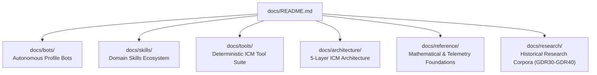

# Hermes ICM Documentation Portal

**System Identity**: Hermes Agent OS & Interpretable Context Methodology (ICM)  
**Host Substrate**: Fedora Kinoite 44 (x86_64) | ws-hermes Distrobox  
**Language Standard**: ASD-STE100 (Simplified Technical English)  
**Root Navigation**: [docs/](file:///var/home/imshubhamsocial/Projects/Workspace/Personal/hermes/docs/)

---

## 1. Documentation Map

This directory contains the canonical documentation for Hermes Agent OS, autonomous bots, skills, tools, and system architecture.  
Always update these documents whenever system changes occur.

---

## 2. Documentation Directory Index

### [1. Autonomous Profile Bots (`docs/bots/`)](file:///var/home/imshubhamsocial/Projects/Workspace/Personal/hermes/docs/bots/README.md)
Contains references for the 4 dedicated profile bots:
* [Overview & Fleet Architecture](file:///var/home/imshubhamsocial/Projects/Workspace/Personal/hermes/docs/bots/README.md)
* [icm-planner: The Socratic Spec Interviewer](file:///var/home/imshubhamsocial/Projects/Workspace/Personal/hermes/docs/bots/icm-planner.md)
* [icm-scaffolder: The 5-Layer Workspace Architect](file:///var/home/imshubhamsocial/Projects/Workspace/Personal/hermes/docs/bots/icm-scaffolder.md)
* [icm-migrator: The AST 5-Bucket Refactorer](file:///var/home/imshubhamsocial/Projects/Workspace/Personal/hermes/docs/bots/icm-migrator.md)
* [icm-auditor: The Zero-Context Substrate Auditor](file:///var/home/imshubhamsocial/Projects/Workspace/Personal/hermes/docs/bots/icm-auditor.md)

### [2. Skills Ecosystem (`docs/skills/`)](file:///var/home/imshubhamsocial/Projects/Workspace/Personal/hermes/docs/skills/README.md)
Contains references for skills conforming to the NVIDIA SkillEvaluator standard:
* [Skills Overview & Architecture](file:///var/home/imshubhamsocial/Projects/Workspace/Personal/hermes/docs/skills/README.md)
* [icm-stage-compiler Reference](file:///var/home/imshubhamsocial/Projects/Workspace/Personal/hermes/docs/skills/icm-stage-compiler.md)
* [Skill Authoring & Certification Guide](file:///var/home/imshubhamsocial/Projects/Workspace/Personal/hermes/docs/skills/skill_authoring_guide.md)

### [3. Deterministic Tools (`docs/tools/`)](file:///var/home/imshubhamsocial/Projects/Workspace/Personal/hermes/docs/tools/README.md)
Contains documentation for deterministic Python and Bash verification tools in `.hermes/tools/icm/`:
* [Deterministic Tool Suite Manual](file:///var/home/imshubhamsocial/Projects/Workspace/Personal/hermes/docs/tools/README.md)

### [4. Architecture & Invariants (`docs/architecture/`)](file:///var/home/imshubhamsocial/Projects/Workspace/Personal/hermes/docs/architecture/README.md)
Contains specifications of system invariants and core methodology:
* [5-Layer ICM Methodology](file:///var/home/imshubhamsocial/Projects/Workspace/Personal/hermes/docs/architecture/README.md)
* [The 10 Non-Negotiable Compiler Rules](file:///var/home/imshubhamsocial/Projects/Workspace/Personal/hermes/docs/architecture/ten_compiler_rules.md)
* [Invariants, Scoping, and Path Isolation](file:///var/home/imshubhamsocial/Projects/Workspace/Personal/hermes/docs/architecture/invariants_and_isolation.md)

### 5. Historical Corpora & Mathematical Foundations
* [docs/reference/](file:///var/home/imshubhamsocial/Projects/Workspace/Personal/hermes/docs/reference/): Attention physics, speculative telemetry, and mathematical foundations.
* [docs/research/](file:///var/home/imshubhamsocial/Projects/Workspace/Personal/hermes/docs/research/): Historical research corpora from GDR30 through GDR40.
* [docs/research/GDR40/Output/LEARNING.md](file:///var/home/imshubhamsocial/Projects/Workspace/Personal/hermes/docs/research/GDR40/Output/LEARNING.md): Operational guide and self-learning manual.

---

## 3. Maintenance and Update Protocol

Follow these three rules when updating documentation:
1. **Enforce ASD-STE100**: Keep sentences under 25 words. Use simple words and active voice.
2. **One Fact, One Home**: Link to canonical invariants in [.hermes/_config/](file:///var/home/imshubhamsocial/Projects/Workspace/Personal/hermes/.hermes/_config/). Never duplicate rules across files.
3. **Verify Links**: Ensure all referenced paths use valid `file:///` links.
