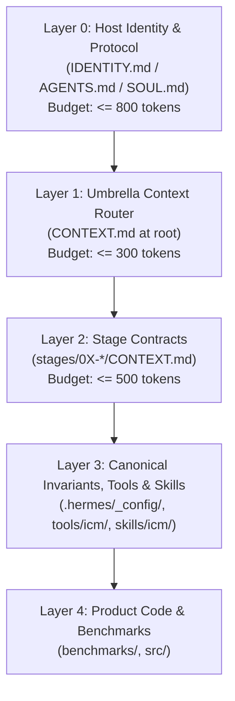

# 5-Layer Interpretable Context Methodology (ICM) Reference

**Methodology**: Interpretable Context Methodology (ICM)  
**Language Standard**: ASD-STE100  
**Parent Index**: [docs/README.md](file:///var/home/imshubhamsocial/Projects/Workspace/Personal/hermes/docs/README.md)

---

## 1. Executive Summary

Interpretable Context Methodology (ICM) treats LLM context windows as physical memory registers.  
It replaces monolithic prompts with bounded, deterministic context layers.  
Each layer has a defined token budget, strict inputs, and unambiguous exit criteria.

---

## 2. Layer Specifications

### Layer 0: Host Identity and Operational Protocol
* **Locations**: [AGENTS.md](file:///var/home/imshubhamsocial/Projects/Workspace/Personal/hermes/AGENTS.md), [.hermes/SOUL.md](file:///var/home/imshubhamsocial/Projects/Workspace/Personal/hermes/.hermes/SOUL.md)
* **Token Budget**: $\le 800$ tokens.
* **Role**: Defines compiler rules, substrate persona, and hardware ceilings.
* **Invariant**: Never explore the filesystem randomly. Route through Layer 1.

### Layer 1: Umbrella Task Router
* **Location**: [CONTEXT.md](file:///var/home/imshubhamsocial/Projects/Workspace/Personal/hermes/CONTEXT.md) at workspace root.
* **Token Budget**: $\le 300$ tokens.
* **Role**: Maps high-level goals and project phases to specific stage directories.
* **Invariant**: Contains zero implementation code. Acts solely as a traffic controller.

### Layer 2: Stage Contracts
* **Locations**: `stages/01-spec/CONTEXT.md`, `stages/02-scaffold/CONTEXT.md`, etc.
* **Token Budget**: $\le 500$ tokens per stage.
* **Role**: Defines inputs, outputs, verification commands, and exit criteria for one task.
* **Invariant**: Strict one-way dependencies. Stage $N$ depends only on Stage $N-1$.

### Layer 3: System Invariants, Tools, and Skills
* **Locations**: [.hermes/_config/](file:///var/home/imshubhamsocial/Projects/Workspace/Personal/hermes/.hermes/_config/), [.hermes/tools/icm/](file:///var/home/imshubhamsocial/Projects/Workspace/Personal/hermes/.hermes/tools/icm/), [.hermes/skills/icm/](file:///var/home/imshubhamsocial/Projects/Workspace/Personal/hermes/.hermes/skills/icm/)
* **Role**: Canonical ground truth, POSIX/Python validators, and portable skills.
* **Invariant**: "One Fact, One Home". Never duplicate Layer 3 rules into stage contracts.

### Layer 4: Product Code and Benchmarks
* **Locations**: [benchmarks/](file:///var/home/imshubhamsocial/Projects/Workspace/Personal/hermes/benchmarks/), `src/`
* **Role**: Final application deliverables, simulation engines, and benchmark suites.
* **Invariant**: Verified by deterministic Playwright and headless Chromium test contracts.

---

## 3. Context Boundaries and KV Cache Hygiene

Monolithic context windows degrade model reasoning as conversational history grows.  
ICM enforces clean boundaries across tasks:
* **Inside a stage**: Use `/goal` with a maximum of 8 turns and an attached shell gate.
* **Across stage boundaries**: Execute `/new --yes` to wipe the KV cache completely.
* **Stateless execution**: Automated pipelines run `hermes chat --no-session-persistence -q`.

---

## 4. Documentation Links

* [The 10 Non-Negotiable Compiler Rules](file:///var/home/imshubhamsocial/Projects/Workspace/Personal/hermes/docs/architecture/ten_compiler_rules.md)
* [Invariants, Scoping, and Path Isolation](file:///var/home/imshubhamsocial/Projects/Workspace/Personal/hermes/docs/architecture/invariants_and_isolation.md)
