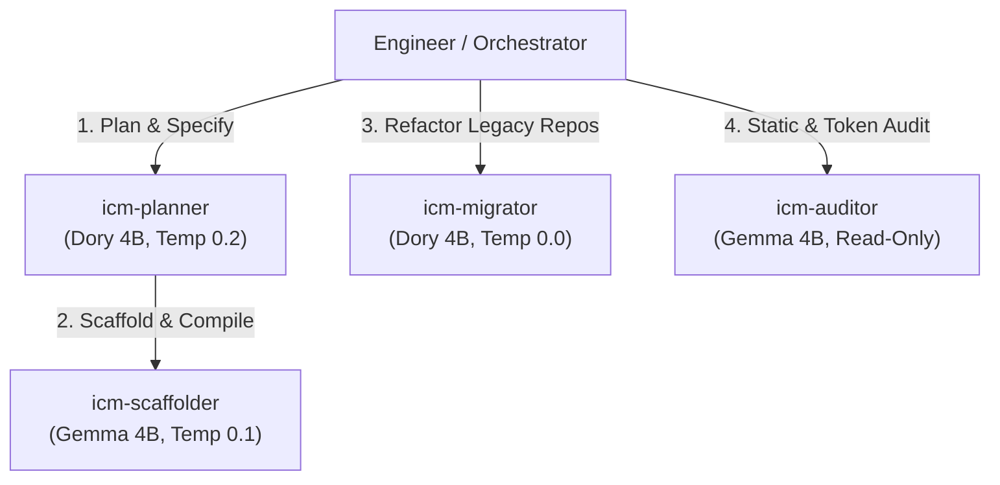

# Autonomous Profile Bots Reference Manual

**Substrate**: Hermes Agent OS Profile Fleet  
**Directory**: `~/.hermes/profiles/`  
**Language Standard**: ASD-STE100  
**Parent Index**: [docs/README.md](file:///var/home/imshubhamsocial/Projects/Workspace/Personal/hermes/docs/README.md)

---

## 1. Fleet Architecture

Hermes organizes autonomous capabilities into dedicated, isolated profiles.  
Each profile has its own configuration, memory database, and persona.  
This separation protects context windows and prevents persona degradation.



---

## 2. Profile Fleet Specifications

| Profile Name | Model | Temperature | Bundled Skills | Role Tag | Documentation Link |
| :--- | :--- | :--- | :--- | :--- | :--- |
| **`icm-planner`** | `nemotron-dory-1.0-looped-4b` | 0.2 | Disabled (`.no-bundled-skills`) | Spec Architect | [icm-planner.md](file:///var/home/imshubhamsocial/Projects/Workspace/Personal/hermes/docs/bots/icm-planner.md) |
| **`icm-scaffolder`** | `gemma-4-exact-4b` | 0.1 | Disabled (`.no-bundled-skills`) | Workspace Architect | [icm-scaffolder.md](file:///var/home/imshubhamsocial/Projects/Workspace/Personal/hermes/docs/bots/icm-scaffolder.md) |
| **`icm-migrator`** | `nemotron-dory-1.0-looped-4b` | 0.0 | Disabled (`.no-bundled-skills`) | AST Refactorer | [icm-migrator.md](file:///var/home/imshubhamsocial/Projects/Workspace/Personal/hermes/docs/bots/icm-migrator.md) |
| **`icm-auditor`** | `gemma-4-exact-4b` | 0.0 (Read-Only) | Disabled (`.no-bundled-skills`) | Zero-Context Auditor | [icm-auditor.md](file:///var/home/imshubhamsocial/Projects/Workspace/Personal/hermes/docs/bots/icm-auditor.md) |

---

## 3. Fleet Provisioning and Isolation

All profiles are created using the deterministic provisioning script:  
`~/.hermes/profiles/provision_icm_fleet.sh`

Each profile directory contains:
* `config.yaml`: Sets model endpoint, temperature, terminal settings, and external skill directories.
* `profile.yaml`: Sets role description for multi-profile Kanban routing.
* `SOUL.md`: Injects the strict persona and operating protocol.
* `.no-bundled-skills`: Prevents upstream skill updates from injecting unneeded skills.

---

## 4. Execution Patterns

Engineers invoke profiles through four surfaces:

1. **CLI Invocations**:
   ```bash
   hermes -p <profile-name> chat -q "<prompt>"
   ```
2. **In-Chat Slash Commands**:
   ```bash
   /new --yes <stage-name>
   /goal gate add <verification-command>
   /goal <objective>
   /goal clear
   ```
3. **Messaging Gateway Mentions**:
   ```text
   @<profile-name> <instructions>
   ```
4. **Kanban Multi-Agent Delegation**:
   ```bash
   /kanban create "Task Title" --assignee <profile-name>
   ```
