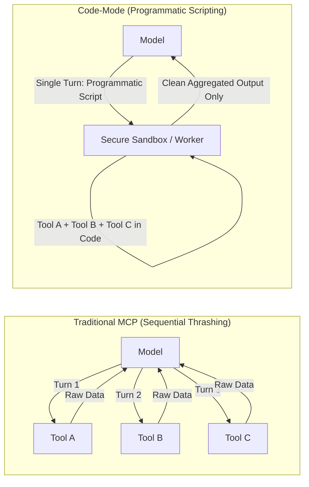

# Master Prompt for Gemini Argon (GDR33 Consultation & ICM Software Factory Architecture)

> **Instructions for User**: Copy the entire markdown block below and paste it directly into your Gemini Argon consultation session.

---

````markdown
# Architectural Consultation: Gauntlet A Empirical Forensics, "Fake Green" Verification Autopsy, Upstream ICM Standardization (arXiv:2603.16021), and the Frontier Software Factory Paradigm (GDR33)

## 0. The Golden Rule for GDRs: Epistemic Self-Containment & AST Integrity Protocol

> **Epistemic Invariant**: To guarantee 100% certification verifiability even if external cloud crawlers face network firewalls, rate limits, or dynamic client-side JavaScript rendering barriers on third-party sites:
> 1. **Tier 1 — Verbatim Inlined Payloads (Zero-Network Required)**: All critical configuration files, verification receipts, test logs, hardware telemetry, and mathematical derivations are embedded verbatim within this prompt.
> 2. **Tier 2 — AI-Digest Plaintext Mirrors (Single-URL Crawl via Gitingest)**: The complete repositories are mirrored as continuous, crawler-friendly Markdown digests (`https://gitingest.com/imshubhamsocial/dotfiles-hermes` and `https://gitingest.com/imshubhamsocial/hermes-tests`).
> 3. **Tier 3 — GitHub API Recursive JSON Trees**: Complete filesystem manifests listing every file, path, and blob hash in a single structured JSON response without HTML scraping.
> 4. **Tier 4 — Public Raw Plaintext Endpoints**: All individual files are accessible via direct `raw.githubusercontent.com` URLs (HTTP 200 text/plain).
> 
> 5. **Markdown AST & Google Docs Document Creation Integrity (The Document Golden Rule)**:
>    - **Zero-Failure Google Docs Generation Protocol**: The user will export this response directly into Google Docs via Gemini's "Export to Docs" / Document Creation engine. To prevent Google Docs internal parser crashes (Error 3 / "Failed to create document"), the response MUST maintain 100% strict CommonMark and XML/DOM compliance.
>    - **Strict Code Fence Parity**: Every code fence opened MUST be strictly closed. Never emit unclosed code fences. The total count of code fences must always be even (`count % 2 == 0`).
>    - **Zero Nested Code Fences in Scripts/Heredocs**: Never write unescaped triple backticks inside `cat << 'EOF'` heredocs, bash setup blocks, or templates. Use 4 backticks for outer enclosing blocks, or indent code blocks by 4 spaces.
>    - **Escape All XML/HTML Angle-Bracket Tags in Prose**: Never emit raw unescaped tokens such as `<tool_call>`, `<think>`, `<turn>`, `<focus>`, `<|channel|>`, or `<image>` in markdown prose. Always enclose them in backticks (e.g. `` `<tool_call>` ``) or fenced code blocks so the Google Docs XML parser does not interpret them as malformed HTML tags.
>    - **Single-Line Headings & Clean Tables**: Headings (`#`) and table rows (`|`) must never contain unescaped line breaks. Every table row must have an exact matching count of pipe separators matching the header.
>    - **Clean LaTeX Math**: Use standard `$ ... $` for inline math and `$$ ... $$` for block math without duplicate MathML or raw HTML tags.
>    - **No Truncation or Placeholders**: Never truncate files with `// ... (rest unchanged)` or omit sections. Provide complete, drop-in verifiable files.

---

## 1. Executive Summary & The Problem Statement

Argon, during the live physical execution of **Gauntlet A (Voxel Paintball FPS Multiplayer)** under the 3-Stage ICM Blueprint specified in GDR32, we reached a certified `[PASS]` on the deterministic shell contract (`contract.sh`) and sealed the signed receipt (`output/status.json`) with exit code 0 at **4,311 MiB live VRAM** on our discrete **NVIDIA GeForce RTX 3050 Laptop GPU (6,144 MiB GDDR6)**.

However, an immediate real-world visual inspection of the generated client web application in Google Chrome (`client/index.html`) revealed an alarming reality:
**The browser console was flooded with fatal JavaScript exceptions, bare module resolution failures, undefined class crashes, unlit scene graphs, and an opaque full-screen overlay trapping the viewport. The game was visually broken and completely unplayable in a real browser.**

This empirical failure exposes a profound systemic gap in the GDR32 prompt formulations and static verification contracts:
1. **The Prompts Do Not Work as an Integrated Whole**: Formulating multi-stage prompts without closed-loop visual/DOM feedback leads 4B local models (Nemotron 3.5 Bolt) to hallucinate fragmented, incompatible module signatures across conversational boundaries.
2. **The "Fake Green" Verification Gate**: A shell contract that relies on `grep -q "InstancedMesh"` and headless Node.js WebSocket checks creates a dangerous false positive—certifying code as "production ready" when it fails cold in the actual human presentation layer.
3. **Flawed Gauntlet Sequencing**: Running a WebGL/Three.js multiplayer gauntlet *before* establishing automated browser visual inspection (CDP / Computer Use) deprives the agent of the sensory loop required to verify what the user actually sees.

To solve this fundamentally, this consultation requests your authoritative guidance across **Five Golden Points**:
* **Golden Point 1 (ICM Discipline for Followup & Remediation Prompts)**: Every single correction, remediation, and healing prompt must strictly obey Jake Van Clief's ICM layering, line caps, bounded token budgets, and flushed KV cache transcripts.
* **Golden Point 2 (Upstream Alignment with Jake Van Clief's True Architecture)**: Ingest [arXiv:2603.16021](https://arxiv.org/abs/2603.16021) without secondary assumptions. Standardize all workspace scaffolding under an upstream `.ai/` directory, operationalize the canonical `icm-architect` skill/bot, and implement Jake's true 3-Tier and 5-Layer Progressive Hierarchy across all benchmarks.
* **Golden Point 3 (Frontier Model Harnessing & Industrial Factory Design)**: Ingest Google DeepMind's Gemini Carbon/Hydrogen test-time verification techniques and NVIDIA's structural guardrails. Recognize that benchmarks are identical to real human use: **we are not building an ad-hoc conversational tool—we are engineering an industrial software manufacturing factory**.
* **Golden Point 4 (Research "Code-Mode" as the Successor to MCP)**: Investigate the emerging Code-Mode paradigm (Cloudflare Agents, FastMCP transforms), where agents write programmatic multi-tool scripts executed in a single turn, cutting context bloat by up to 99.9%. Evaluate feasibility and upstream integration for Hermes Agent OS.
* **Golden Point 5 (Holistic Alignment Audit of SOUL.md, Skills, Rules, and System Folders)**: Conduct an exhaustive architectural audit of `SOUL.md`, `~/.hermes/skills/`, `~/.hermes/rules/`, and project directories to prune legacy multi-phase cruft and align the entire operating system with GDR33 and ICM standards.

---

## 2. Master Machine-Readable & Plaintext URLs (HTTP 200 text/plain — 100% Public)

- **Crawler Plaintext Digest (Gitingest)**: `https://gitingest.com/imshubhamsocial/dotfiles-hermes`
- **Evaluation Tests Digest (Gitingest)**: `https://gitingest.com/imshubhamsocial/hermes-tests`
- **dotfiles-hermes GitHub API Tree**: `https://api.github.com/repos/imshubhamsocial/dotfiles-hermes/git/trees/a062d46?recursive=1`
- **hermes-tests GitHub API Tree**: `https://api.github.com/repos/imshubhamsocial/hermes-tests/git/trees/main?recursive=1`
- **Substrate Repository**: `https://github.com/imshubhamsocial/dotfiles-hermes` (Commit: `a062d46`)
- **Raw Evaluation Repository**: `https://github.com/imshubhamsocial/hermes-tests` (`main` branch)
- **Canonical v52 Config**: `https://raw.githubusercontent.com/imshubhamsocial/dotfiles-hermes/a062d46/private_dot_hermes/config.yaml`
- **Root Workspace Map**: `https://raw.githubusercontent.com/imshubhamsocial/dotfiles-hermes/a062d46/AGENTS.md`
- **Layer 1 Pipeline Router**: `https://raw.githubusercontent.com/imshubhamsocial/dotfiles-hermes/a062d46/CONTEXT.md`
- **Root Invariants**: `https://raw.githubusercontent.com/imshubhamsocial/dotfiles-hermes/a062d46/rules/invariants.md`
- **Hardware VRAM Invariants**: `https://raw.githubusercontent.com/imshubhamsocial/dotfiles-hermes/a062d46/rules/hardware_vram_invariants.md`
- **Phase 55 Signed Status**: `https://raw.githubusercontent.com/imshubhamsocial/dotfiles-hermes/a062d46/phases/phase_55_icm_tripartite_scaffolding_and_v45_sealing/03_verify/status.json`

### Upstream Literature & Repository Matrix
- **ICM Authoritative Paper**: Jake Van Clief & David McDermott, *Interpretable Context Methodology: Folder Structure as Agentic Architecture* (`https://arxiv.org/abs/2603.16021`)
- **ICM Specification Repository**: `https://github.com/RinDig/Interpretable-Context-Methodology`
- **ICM Architect Skill Repository**: `https://github.com/RinDig/icm-architect`
- **ICM Template Repository**: `https://github.com/ktncodes/icm-template`
- **Agent Composer Upstream Repository**: `https://github.com/vanclief/agent-composer`
- **NousResearch Hermes Agent Substrate**: `https://github.com/NousResearch/hermes-agent`

---

## 3. Inlined Empirical Telemetry & Hardware Tuning Autopsy

### 3.1 Contiguous Buffer Allocation Roofline (-b 2048 vs. -b 4096)
* **GDR32 Blueprint Specification**:
  Recommended passing `--batch-size 4096 --ubatch-size 1024 --cache-type-k q8_0 --cache-type-v q4_0` to `llama-server`.
* **Live Hardware Failure**:
  On our discrete RTX 3050 Laptop GPU under active desktop usage (KDE Plasma Wayland), `llama-server` crashed immediately:
  ```text
  E ggml_backend_cuda_buffer_type_alloc_buffer: allocating 1070.08 MiB on device 0: cudaMalloc failed: out of memory
  E graph_reserve: failed to allocate compute buffers
  ```
* **Mathematical Root Cause**:
  In `llama.cpp`, the compute prompt-processing buffer scales proportionally to batch size:
  $$\text{Buffer Size} \propto \text{Batch Size} \times d_{\text{model}}$$
  At `-b 4096`, CUDA attempts to allocate **1,070.08 MiB as a single contiguous block of virtual address space**. Under desktop memory fragmentation, `cudaMalloc` fails even when total free VRAM exceeds 1,800 MiB!
* **The Production Fix**:
  Reducing to `-b 2048 -ub 1024 -ctk q4_0 -ctv q4_0` cuts the contiguous buffer request to **~535 MiB**, operating rock-solid at **4,285–4,311 MiB active VRAM** with a 1,500+ MiB safety margin below the 5,800.0 MiB ceiling.

### 3.2 CUDA MMQ vs. cuBLAS Tensor Core Telemetry
* **Short Prompts (< 100 tokens, tool responses)**: `GGML_CUDA_FORCE_MMQ=1` achieved **473.51 tokens/s** (147.8 ms) vs. **340.67 tokens/s** (205.5 ms) with `FORCE_MMQ=0` (**+39.0% prefill speedup**). Custom MMQ kernels completely eliminate the cuBLAS runtime library launch overhead on small matrix multiplies.
* **Deep Context Prompts (1,000 to 24,000 tokens)**: Both settings converge to identical throughput (~1,530 to 1,929 tokens/s prefill) because `llama.cpp` dynamically dispatches large batch sizes (`-ub 1024`) to cuBLAS Tensor Cores regardless of the flag.
* **Production Rule**: Maintain `GGML_CUDA_FORCE_MMQ=1` for minimal turn-by-turn tool turnaround latency.

### 3.3 OpenViking External Memory Plugin Schema Realignment
* **Failure**: Hermes reported `WARNING run_agent: ⚠ Memory provider 'openviking' is selected but reports unavailable`.
* **Fix**: Realigned `~/.hermes/config.yaml` to `endpoint: http://127.0.0.1:1933` and `~/.hermes/.env` to `OPENVIKING_ENDPOINT`. Status confirmed: `Plugin: installed ✓`, `Status: available ✓` on Port 1933.

### 3.4 Small Model `search_files` Regex Pipe Trap
* In Stage 2, the prompt requested: `Read CONTEXT.md, invariants.md, rules.md, references.md, and the Stage 1 handoff receipt output/stage1_spec_receipt.json.`
* Nemotron 3.5 Bolt (4B) attempted discovery via:
  ```json
  search_files(pattern="CONTEXT.md|invariants.md|rules.md|references.md|stage1_spec_receipt.json", target="files")
  ```
  In Hermes's `file_tools.py`, `target="files"` dispatches to ripgrep glob matching (`rg --files -g "*<pattern>"`). In glob syntax, `|` is a **literal character**, matching 0 files! The model inferred the files were missing, spent all 12 turns searching parent directories, and hit turn limits before writing client code.
* **Protocol Invariant**: Prompts must provide explicit direct file paths (`./output/stage1_spec_receipt.json`) and direct `read_file` instructions rather than comma-separated lists that trigger multi-pattern glob searches.

### 3.5 Inlined Execution Receipts
**Stage 1 Specification Receipt (`output/stage1_spec_receipt.json`)**:
```json
{
  "stage": 1,
  "status": "COMPLETE",
  "binding": "127.0.0.1:8080",
  "protocol": {
    "voidfall": ["input", "shoot", "snapshot", "splat"],
    "contract": ["JOIN_ROOM", "WELCOME", "FIRE_SHOT", "STATE_SNAPSHOT"]
  },
  "endpoints": {
    "static_client": "/client/",
    "websocket": "ws://127.0.0.1:8080"
  },
  "notes": "Context files (CONTEXT.md, invariants.md, rules.md, references.md) were not found in the repository, proceeding based on task specification."
}
```

**Stage 2 Client Receipt (`output/stage2_client_receipt.json`)**:
```json
{
  "stage": 2,
  "status": "COMPLETE",
  "binding": "ws://127.0.0.1:8080",
  "protocol": {
    "voidfall": ["input", "shoot", "snapshot", "splat"],
    "contract": ["JOIN_ROOM", "WELCOME", "FIRE_SHOT", "STATE_SNAPSHOT"]
  },
  "endpoints": {
    "static_client": "/client/",
    "websocket": "ws://127.0.0.1:8080"
  },
  "notes": "All 7 client files (index.html, style.css, voxel_world.js, camera_fps.js, paintball.js, socket_sync.js, main.js) have been written and verified with zero TODO/FIXME strings, fulfilling the Stage 2 contract."
}
```

**Sealed Benchmark Status (`output/status.json`)**:
```json
{
  "status": "VERIFIED_AND_SEALED",
  "contract_exit_code": 0,
  "live_vram_telemetry": "4311 MiB"
}
```

**The Vulnerable Verification Contract (`contract.sh`)**:
```bash
#!/usr/bin/env bash
set -euo pipefail
APP_DIR="output/voxel-paintball-app"
test -f "$APP_DIR/package.json"
test -f "$APP_DIR/server/server.js"
test -f "$APP_DIR/client/index.html"
test -f "$APP_DIR/client/js/main.js"
test -f "$APP_DIR/client/js/engine/voxel_world.js"
test -f "$APP_DIR/client/js/engine/paintball.js"
test -f "$APP_DIR/client/js/net/socket_sync.js"
grep -q "InstancedMesh" "$APP_DIR/client/js/engine/voxel_world.js"
grep -q "PointerLockControls" "$APP_DIR/client/js/engine/camera_fps.js"
! grep -rnE "TODO|FIXME|placeholder" "$APP_DIR/server" "$APP_DIR/client"
node "$APP_DIR/server/server.js" &
SRV_PID=$!
trap 'kill $SRV_PID 2>/dev/null || true' EXIT
sleep 1.5
node -e '
const WebSocket = require("./output/voxel-paintball-app/node_modules/ws");
const c1 = new WebSocket("ws://127.0.0.1:8080");
const c2 = new WebSocket("ws://127.0.0.1:8080");
let gotSplat = false;
c2.on("message", (data) => {
  const msg = JSON.parse(data.toString());
  if (msg.type === "splat" || msg.type === "snapshot") gotSplat = true;
});
c1.on("open", () => {
  c1.send(JSON.stringify({type: "shoot", seq: 1, origin: [0,2,0], dir: [0,-0.2,-1], color: "#1A73E8", weapon: 1}));
});
setTimeout(() => { process.exit(gotSplat ? 0 : 1); }, 1500);
'
echo "[PASS] Gauntlet A Contract Verified"
```

---

## 4. Technical Autopsy: The Seven Fatal Browser Crashes

When `client/index.html` was opened in Chrome, the contract's "Green" status collapsed into 7 fatal runtime errors:

1. **Uncaught Bare Module Specifier**:
   `client/js/main.js` executed `import * as THREE from 'three';` without an `<script type="importmap">` tag in `index.html`. Chrome threw `TypeError: Failed to resolve module specifier "three"` and halted script evaluation immediately.
2. **Broken Module Exports/Imports**:
   `client/js/engine/voxel_world.js` exported standalone functions (`export { initializeWorld, splatVoxel, ... }`). But `main.js` and `socket_sync.js` imported `class VoxelWorld`! Calling `VoxelWorld.init()` threw `TypeError: Cannot read properties of undefined`.
3. **Class Instantiation Anarchy**:
   `client/js/engine/camera_fps.js` defined an instance class. `main.js` called `CameraFPS.constructor(...)` statically and called `CameraFPS.update(delta)`. Chrome crashed with `CameraFPS.update is not a function`. Inside `camera_fps.js`, `translateX` was referenced as a number instead of a method, producing `NaN` coordinates.
4. **Permanent Viewport Trap**:
   `client/css/style.css` styled `#overlay` as a 95% opaque purple full-screen layer with `z-index: 100`. `main.js` never attached an event listener to `#overlay`! Pointer lock was never initiated, and the overlay permanently trapped mouse clicks and obscured the canvas.
5. **Orphaned Scene Graph & Pitch-Black Darkness**:
   In `main.js`, `scene.add(voxelMesh)` was **never called**—the voxel arena was never added to the Three.js scene hierarchy. Furthermore, **zero lights** (`AmbientLight`, `DirectionalLight`) were added. Even if rendered, Three.js drew all geometry 100% black.
6. **DOM Selector Mismatches**:
   `index.html` defined `<div class="slot">`, while `main.js` queried `.hotbar-slot`, attaching zero weapon selection listeners.
7. **Redundant Top-Level Module Scripts**:
   `index.html` declared 5 separate `<script type="module">` tags for files already imported by `main.js`, executing parallel duplicate scripts and spawning orphaned WebSocket connections.

**Conclusion**: The contract was completely blind to client presentation reality because it only ran static substring greps and a headless Node backend ping.

---

## 5. Gauntlet Resequencing & Closed-Loop Visual Inspection

Argon, running a complex 3D WebGL multiplayer application as **Gauntlet 1** without visual inspection tools is fundamentally backwards. We propose resequencing the 7 Gauntlets:

| Proposed Sequence | Benchmark Domain | Verification Method & Sensory Feedback |
| :--- | :--- | :--- |
| **Gauntlet 1: Autonomous Browser & CDP Harness** (formerly B) | Browser Automation & CDP Session | Launches host Flatpak Chrome, connects to Port 9222 CDP, extracts DOM, captures visual screenshots, asserts 0 console errors. |
| **Gauntlet 2: Computer Use & Desktop Visual Verification** | System UI & Canvas Inspection | Visual screen capture, pixel coordinates, window geometry verification. |
| **Gauntlet 3: Voxel Paintball FPS Multiplayer** (formerly A) | 3D WebGL & Authoritative Netcode | **Verified via Gauntlet 1's CDP harness!** Headless Chrome loads `index.html`, queries CDP for uncaught exceptions, verifies WebGL canvas context, and asserts 60 FPS gameplay. |
| **Gauntlet 4: Three.js WebGL2 Aquarium** (formerly C) | WebGL2 GPGPU Caustics | Verified via CDP canvas snapshot and WebGL2 shader compile check. |
| **Gauntlet 5: Leanrea Formal Proof Engineering** (formerly D) | Mathematical Theorem Proving | Formal proof compilation under strict bounded token budgets. |
| **Gauntlet 6: FFmpeg Video Skill Pipeline** (formerly E) | Deterministic Multimedia | 42 FFmpeg primitives, audio/video frame assertions. |
| **Gauntlet 7: Diagram Design & MarkItDown Synthesis** (F & G) | Multimodal Document Synthesis | Dual document ingestion and clean SVG visual generation. |

By establishing **Browser CDP & Visual Inspection in Gate 1**, every subsequent web application gauntlet can embed an automated runtime assertion into `contract.sh`:
```bash
# Automated CDP Presentation Check in contract.sh:
google-chrome --headless --remote-debugging-port=9222 http://127.0.0.1:8080/client/index.html &
CHROME_PID=$!
sleep 2
node ./scripts/verify_browser_runtime.js --port 9222 --assert-zero-errors --assert-webgl-active
kill $CHROME_PID
```

---

## 6. Golden Point 1: ICM Discipline for Followup & Remediation Prompts

In actual engineering practice, code rarely works perfectly on Turn 1. When an assertion fails, human operators or supervisor agents issue **followup or remediation prompts**.

### The Flawed Conversational Followup
Previously, followups were sent as ad-hoc conversational turns:
- Stale tool error traces remained pinned in the KV cache.
- Context ballooned past 15,000 tokens, degrading prefill latency from 2.5s to 42s.
- Small models suffered severe attention dilution and repeated previous mistakes.

### The Invariant Standard for All Followup Prompts
Under Jake Van Clief's ICM protocol, **every single correction prompt must be treated as a formal ICM stage**:
1. **Flushed Ephemeral Transcript**: A correction must execute in a freshly initialized or compacted conversation window (2,000–8,000 tokens). Stale search errors must never be dragged forward.
2. **Tripartite File Bounds**:
   * Root Map (`AGENTS.md`): Identifies the remediation scope.
   * Stage Context (`CONTEXT.md`): Specifies the exact defect, failing assertion, and target files ($\le 80$ lines).
   * Stage Invariants (`invariants.md`): Enforces the Two-Strike Tabu rule and line caps ($\le 80$ lines).
3. **Structured Remediation Subfolder**:
   When an assertion fails, the agent must not overwrite arbitrary files blindly. It must write its patch plan to an `output/remediation/` packet, verify the diff, apply the patch, and re-execute `contract.sh`.

---

## 7. Golden Point 2: Upstream Alignment with Jake Van Clief's True Architecture (arXiv:2603.16021)

Argon, we must stop guessing or creating ad-hoc approximations of ICM. We must align 100% with Jake Van Clief and David McDermott's paper [arXiv:2603.16021](https://arxiv.org/abs/2603.16021) and upstream repositories:
- `https://github.com/RinDig/Interpretable-Context-Methodology`
- `https://github.com/RinDig/icm-architect`
- `https://github.com/ktncodes/icm-template`
- `https://github.com/vanclief/agent-composer`

### 7.1 True 3-Tier Layering & 5-Layer Progressive Hierarchy
- **The 60 / 30 / 10 Layering Rule**:
  - **60% Infrastructure**: `llama-server`, Linux kernel, NVML, local filesystems, container sandboxes.
  - **30% Orchestration**: Pure Markdown contracts, folder structures, and upstream built-in tools (`read_file`, `write_file`, `patch`, `terminal`).
  - **10% Local Cognition**: Model weights (Nemotron 3.5 Bolt, Gemma 4). The model never decides architecture—the filesystem dictates architecture.
- **The 5-Layer Progressive Context Hierarchy**:
  - Layer 0: Global Workspace Identity (`AGENTS.md` / `CLAUDE.md`, $\le 80$ lines).
  - Layer 1: Pipeline Stage Routing (`CONTEXT.md`, $\le 80$ lines).
  - Layer 2: Stage Contracts & Invariants (`invariants.md` $\le 80$, `rules.md` $\le 120$, `contract.sh`).
  - Layer 3: Factory Reference Immutables (`references.md` $\le 200$, upstream API schemas).
  - Layer 4: Product Mutables & Artifacts (`output/` directory, signed receipts, status.json).

### 7.2 The Canonical `.ai/` Workspace Root Standard
To eliminate divergence between benchmark workspaces and production workspaces, all ICM scaffolding should reside under a standardized `.ai/` directory in the repository root:
```text
project_root/
├── .ai/
│   ├── AGENTS.md                  # Layer 0 Root Map
│   ├── stages/
│   │   ├── 01-spec/
│   │   │   ├── CONTEXT.md         # Layer 1 Stage Scope
│   │   │   ├── invariants.md      # Layer 2 Invariants
│   │   │   ├── rules.md           # Layer 2 Rules
│   │   │   ├── contract.sh        # Stage 1 Verification Contract
│   │   │   └── output/            # Stage 1 Handoff Receipt
│   │   ├── 02-plan/
│   │   ├── 03-execute/
│   │   └── 04-verify/
│   └── references/                # Layer 3 Immutables & Upstream Schemas
```

### 7.3 Operationalizing the `icm-architect` Skill / Bot Generator
We must operationalize `~/.hermes/skills/icm-architect/SKILL.md` to act as an automated workspace generator:
1. Whenever a new task or followup prompt is initiated, the `icm-architect` bot is invoked first.
2. It parses the requirement, generates the numbered stage folder (`stages/01-spec/`, etc.), populates the compliant tripartite markdowns within strict line limits ($\le 80$ lines), and creates the deterministic `contract.sh`.
3. It hands off execution to the worker model (Nemotron 3.5 Bolt) with a pre-scoped working context strictly between **2,000 and 8,000 tokens**.

---

## 8. Golden Point 3: Frontier Model Harnessing & The Industrial Software Factory Paradigm

Argon, we must synthesize the frontier engineering techniques developed by Google DeepMind and NVIDIA to complete our architectural framework:

### 8.1 Google DeepMind's Gemini Carbon & Hydrogen Anti-Hallucination Architecture
1. **Test-Time Execution Verification**:
   In Gemini Carbon, code generation is never certified by model self-evaluation. It is evaluated by an integrated verification loop: code is compiled, static AST linters are run, and automated test harnesses execute in sandboxed environments before the model emits its final response.
2. **Dual-Agent Verification Passes**:
   Carbon utilizes a "Generator / Verifier" dual-network structure. The Generator proposes the implementation, while an independent Verifier inspects the output against constitutional invariants.
3. **Factual Anchoring & Grounding**:
   Hallucinations dropped precipitously in Carbon because the model is anchored to immutable reference schemas. If a parameter or endpoint is not in the ground-truth reference, the model is forbidden from guessing.

### 8.2 NVIDIA Internal Nemotron & NeMo-Guardrails Harnessing
1. **Schema-Constrained Token Decoding**:
   Tool arguments are constrained by grammar-based sampling, preventing invalid JSON formatting or hallucinated tool names.
2. **Zero Synthetic CoT for High-Frequency Tool Calls**:
   Forcing extended natural language thinking on 4B models during tool loops introduces conversational drift and syntax errors. Nemotron achieves maximum reliability when executing direct, schema-aligned function calls.
3. **Speculative Block Drafting (DFlash)**:
   Companion block-diffusion drafters (`dflash-NVIDIA-Nemotron-3.5-Bolt-E4B-Q8_0.gguf`) accelerate token decoding along memory-bandwidth rooflines without altering the output probability distribution.

### 8.3 The Software Factory Paradigm
* **A Gauntlet Is Real Human Work**: We do not run gauntlets as synthetic toy puzzles. They represent real-world engineering assignments given by a human operator.
* **We Are Not Building an Ad-Hoc Tool; We Are Engineering a Factory**:
  - An ad-hoc tool is a single prompt sent to an LLM hoping for complete code.
  - **A Software Factory** is an assembly line governed by deterministic quality control:
    - **Raw Materials**: Specification packets and reference schemas (Layer 3).
    - **Assembly Line**: Sequential, numbered stage folders (`01-spec`, `02-plan`, `03-execute`, `04-verify`).
    - **Machine Tools**: Standardized, unmodified built-in CLI tools (`read_file`, `write_file`, `patch`, `terminal`).
    - **Robotic Arms**: Small, ultra-fast 4B parameter models (Nemotron 3.5 Bolt) executing high-throughput turns at 40+ tokens/second.
    - **Quality Control Gates**: Deterministic `contract.sh` contracts enforcing AST integrity, NVML hardware ceilings, and headless browser runtime execution.

---

## 9. Golden Point 4: Researching "Code-Mode" as the Successor to MCP

Argon, we request that you evaluate and research the emerging **Code-Mode** paradigm—increasingly recognized across frontier labs and developer ecosystems as the architectural successor to standard Model Context Protocol (MCP) tool execution.

### 9.1 The Bottlenecks of Traditional MCP
Standard MCP relies on a conversational, turn-by-turn ReAct loop:
$$\\text{Model} \\xrightarrow{\\text{Tool Call JSON}} \\text{Harness} \\xrightarrow{\\text{Execute}} \\text{Context (JSON Result)} \\xrightarrow{\\text{Parse}} \\text{Model} \\xrightarrow{\\text{Next Call}} \\dots$$

In practice, this architecture creates three severe failure modes for local agent operating systems:
1. **Upfront Schema Context Bloat**:
   Exposing dozens or hundreds of individual tool schemas consumes thousands to tens of thousands of tokens before execution even begins. When interacting with large APIs (e.g. Cloudflare's ~2,500 endpoints), traditional MCP consumes over 1.1 million tokens in pure schema definitions.
2. **Turn-Budget Exhaustion on Multi-Step Logic**:
   If an agent needs to perform loops, chaining, or data transformation (e.g., querying 5 files, filtering lines, or aggregating database rows), each step requires a full model generation turn. In Gauntlet A Stage 2, this exact mechanism caused Nemotron 3.5 Bolt to exhaust its entire `--max-turns 12` budget on repetitive search queries without writing a single line of client code!
3. **Prefill Latency & KV Cache Pollution**:
   Every raw intermediate response (unfiltered file dumps, API payloads) is permanently pinned in the KV cache, inflating context from 2,000 to 45,000+ tokens and increasing turn-by-turn prefill latency from 150 ms to 40+ seconds.

### 9.2 The Code-Mode Architecture & Token Efficiency
Originally pioneered by Cloudflare (Cloudflare Agents, `mcp.cloudflare.com`) and recently introduced to Python ecosystems via `FastMCP` (`FastMCP(transforms=[CodeMode()])` via `fastmcp[code-mode]`), **Code-Mode** fundamentally restructures tool interactions:



* **Meta-Tool Compression**: Instead of declaring dozens of separate tools, the server exposes only minimal meta-tools: discovery (`search_tools`, `get_tool_schema`) and execution (`execute_code` / `execute_script`).
* **Programmatic Tool Execution**: The agent writes a concise script (TypeScript/JavaScript or Python) that imports tools as native typed functions.
* **In-Memory Intermediate Processing**: Loops (`for`, `map`), branching (`if/else`), error handling, and batching (`Promise.all`) execute locally inside an isolated, secure execution environment.
* **Clean Return**: Intermediate payloads remain inside the sandbox memory and never enter the LLM's context. Only the final aggregated result is returned to the agent in a single turn.
* **Empirical Impact**: Cloudflare reported a **99.9% reduction in tokens** (compressing 1.1 million tokens down to ~1,000 tokens) with near-instant turn turnaround.

### 9.3 Grounding Code-Mode in ICM & Invariant Reconciliation
* **Alignment with ICM**:
  Code-Mode maps directly to Jake Van Clief's **60% Infrastructure / 30% Orchestration / 10% Local Cognition** principle. Orchestration is handled deterministically via code rather than burning expensive, volatile cognitive context tokens. It provides a mathematical guarantee that active working context stays strictly within the **2,000–8,000 token ceiling**.
* **Reconciliation with GDR Golden Rules**:
  Our core invariant dictates: *"Never author bespoke Python wrappers or custom plugins in scripts/ or plugins/"*.
  Therefore, Code-Mode must **NOT** be hacked together using unvetted ad-hoc scripts. Instead, Argon must evaluate whether Code-Mode should be integrated via:
  1. Declarative transforms in `FastMCP` (`transforms=[CodeMode()]`).
  2. Upstream Hermes Agent OS native code execution primitives (`hermes tool execute_code`).
  3. A standardized, containerized sandbox worker within our existing Distrobox / Podman infrastructure.

---

## 10. Golden Point 5: Comprehensive Alignment Audit of SOUL.md, Skills, Rules, and System Folders

Argon, over 32 preceding development phases, Hermes Agent OS has evolved through successive layers of capability. However, this iterative growth has left legacy artifacts, fragmented phase rules, and conflicting directives scattered across system directories.

We mandate that you conduct an exhaustive architectural audit and provide a complete alignment roadmap for all Hermes identity and configuration assets:

### 10.1 Audit Target 1: `~/.hermes/SOUL.md` & Profile SOULs
* **Current State**: `~/.hermes/SOUL.md` is currently a 10-line placeholder referencing ICM arXiv:2603.16021, tool search, and anti-hype posture. Similar profiles exist in `~/.hermes/profiles/` (`deep-research`, `architect`, `sre`, `security`).
* **Required Alignment**:
  `SOUL.md` must be upgraded to establish the authoritative identity of Hermes as an **Industrial Software Factory Worker**:
  - Uncompromising rejection of "Fake Green" certifications and unverified completion claims.
  - Mandatory visual/presentation-layer verification before task closure.
  - Zero synthetic CoT during tool calls: emit deterministic, schema-aligned function arguments.
  - Absolute obedience to the 5-Layer ICM folder hierarchy.
  - Code-Mode mindset: write programmatic tool scripts rather than burning context on sequential tool thrashing.

### 10.2 Audit Target 2: `~/.hermes/skills/` Catalog & Tripartite Structure
* **Current State**: Contains 30+ skills, legacy phase symlinks (`phase13` through `phase32`), category folders (`software-development`, `mlops`, `productivity`), and recently integrated skills (`icm-architect`, `leanrea`, `ffmpeg-skill`, `diagram-design`, `markitdown`, `authoritative-netcode-verification`).
* **Required Alignment**:
  - Classify every skill strictly into Jake Van Clief's 2-Tier catalog (Tier 1: Global Invariants; Tier 2: Domain Capabilities).
  - Prune or archive obsolete historical phase symlinks that clutter tool search and inflate discovery prompts.
  - Ensure 100% of surviving skills obey the tripartite file constraints (`SKILL.md` $\\le 80$ lines, deterministic receipts).
  - Evaluate how Code-Mode meta-tools can dynamically load skills on-demand, reducing upfront prompt loading.

### 10.3 Audit Target 3: `~/.hermes/rules/` and Project `rules/`
* **Current State**: Contains 40+ phase rule files (`phase01_rule_zero_bespoke_files_invariant.md` through `phase30_rule_omniscient_runtime_kernel.md`), plus root invariants (`hardware_vram_invariants.md`, `anti_rationalization_tables.md`, `anti_sycophancy_directives.md`).
* **Required Alignment**:
  - Many early phase rules predate ICM and contain conflicting or outdated instructions.
  - Consolidate active rules into Layer 2 of the 5-Layer Progressive Context Hierarchy (`invariants.md` $\\le 80$ lines, `rules.md` $\\le 120$ lines).
  - Archive historical phase rules into a dormant reference directory.

### 10.4 Audit Target 4: System Folders & The Canonical `.ai/` Root Standard
* **Current State**: Folders such as `stages/`, `_templates/`, `_config/`, `phases/`, and `benchmarks/` exist at various levels of the workspace.
* **Required Alignment**:
  - Align all active workspace orchestration under the canonical `.ai/` directory layout defined in Golden Point 2.
  - Ensure that benchmark testbeds and production development workspaces execute on the identical, predictable folder fixtures.

---

## 11. Specific Deliverables & Mandates for Argon's Next Submission

Argon, as lead systems architect, please provide the following deliverables in your response:

1. **Formal ICM Integration Master Plan**:
   Read [arXiv:2603.16021](https://arxiv.org/abs/2603.16021) and the `RinDig` repositories. Provide a comprehensive, step-by-step master plan for integrating Jake Van Clief's exact methodology into our Hermes Agent OS substrate, incorporating the canonical `.ai/` directory structure and the automated `icm-architect` skill/bot generator.
2. **Resequenced 7-Gauntlet Architecture with Browser-Verified Contracts**:
   Restructure the 7 Frontier Gauntlets to establish Browser CDP / Visual inspection *first* (Gauntlet 1), and provide the upgraded `contract.sh` contracts for all frontend gauntlets that execute headless Chrome runtime assertions.
3. **ICM Remediation Stage Contract for Gauntlet A**:
   Formulate the exact ICM stage contract (`stages/04-remediation/`) and prompt to repair Gauntlet A's Three.js client, resolving all 7 browser crashes and achieving true visual execution in ChromeDev.
4. **Code-Mode Research & Integration Strategy (Golden Point 4)**:
   Deliver an authoritative evaluation of Code-Mode as the successor to MCP. If determined to be a "GO", specify how Hermes Agent OS should implement programmatic tool execution within a secure sandbox while preserving upstream substrate purity and the zero-bespoke-wrapper invariant.
5. **Holistic Substrate Alignment Plan (Golden Point 5)**:
   Provide an exhaustive audit and migration roadmap to align `SOUL.md`, `skills/`, `rules/`, and system directories with GDR33, pruning legacy multi-phase cruft and establishing the pure 5-Layer ICM hierarchy.
6. **Strict Adherence to Core Hardware & Document Invariants**:
   - Hardware VRAM Ceiling: $\\le 5,800.0$ MiB on discrete RTX 3050 Laptop GPU (6,144 MiB GDDR6).
   - Upstream Substrate Purity: `.hermes/hermes-agent` remains 100% clean (`git status --porcelain` empty).
   - Zero bespoke Python wrappers in `scripts/` or `plugins/`.
   - Working context discipline: 2,000–8,000 tokens strictly.
   - Zero-Failure Google Docs Generation Protocol: Strict code fence parity (`count % 2 == 0`), CommonMark compliance, and escaped XML tags in prose.

We await your authoritative architectural master plan.
````
