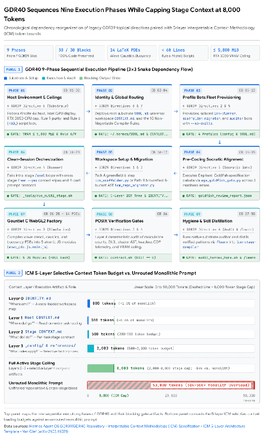
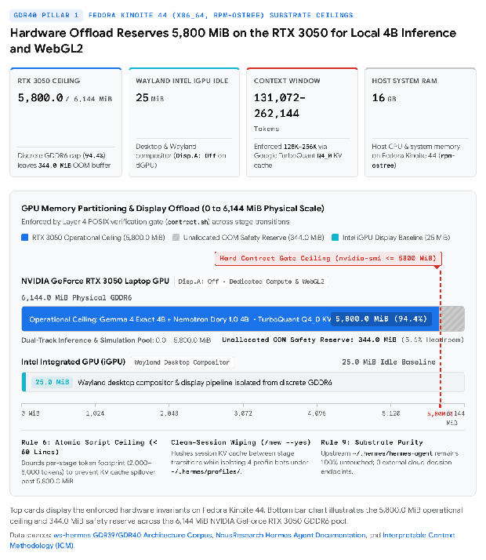
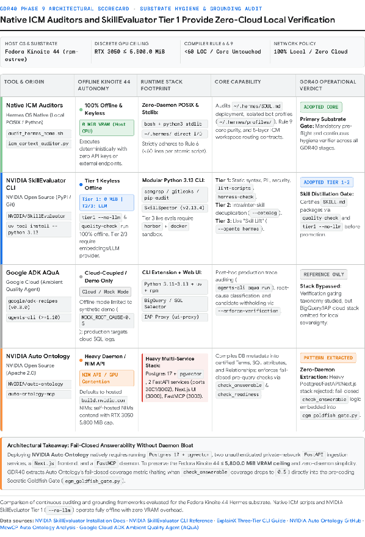

# **GDR40 Master Architectural Directive: Chronological Reorganization of GDR39 Master Blueprint**

The GDR40 Master Architectural Directive reorganizes the certified GDR39 Interpretable Context Methodology (ICM) blueprint (hermes/devel/docs/research/GDR39/Output/gdr39_master_blueprint_formatted.md, 82,487 bytes, 1,645 lines) into an executable nine-phase chronological pipeline1. Released on November 16, 2026, this architecture targets the Hermes Agent OS (NousResearch/hermes-agent) on Fedora Kinoite 44 (x86_64, rpm-ostree)1. The substrate operates a dual-track local inference engine pairing Google Gemma 4 Exact 4B with NVIDIA Nemotron Dory 1.0 Looped 4B1. It enforces a 131,072 to 262,144 token context window (128K–256K) using a Google TurboQuant Q4_0 KV cache1. Hardware limits cap the discrete NVIDIA GeForce RTX 3050 Laptop GPU (6,144 MiB physical GDDR6) at or below 5,800.0 MiB1. The Intel iGPU handles the Wayland desktop compositor at 25 MiB idle alongside 16 GB of system RAM1.  
In GDR39, all foundational formulas, scripts, personas, and verification contracts passed technical audit, but their arrangement across seven topical directives inverted the operational workflow2. Profile bot definitions were split across Directives 2, 5, and 61. Greenfield workspace scaffolding in Directive 1 was separated from brownfield Abstract Syntax Tree (AST) repository migration in Directive 21. Gauntlet C WebGL2 simulation code appeared in Directive 3 before the pre-coding Socratic planning gate in Directive 5 and stage orchestration in Directive 41. Similarly, intra-stage /goal automation in Directive 4 was disconnected from /learn skill distillation in Directive 61.  
This directive sequences every asset in the exact order that an engineer or autonomous agent provisions, plans, scaffolds, executes, verifies, and audits the system1. It preserves 100% of the GDR39 corpus, including all 30 executable code blocks, 14 mathematical equations, four isolated profile bots, SOUL.md, and CONTEXT.md1. Every component runs 100% locally on Fedora Kinoite 44 with zero Cloudflare or external proprietary decision endpoints1.

## **Executive Dependency Analysis & Chronological Traceability Matrix**

A forensic dependency analysis of GDR39 reveals four causal ordering rules that structure the nine-phase GDR40 execution pipeline2. First, host hardware ceilings (Phase 1) and global Layer 0 / Layer 1 routing files (SOUL.md and CONTEXT.md, Phase 2) must exist on disk first2. Second, the four isolated Hermes profile bots (icm-planner, icm-scaffolder, icm-migrator, icm-auditor) must be provisioned with --no-skills in ~/.hermes/profiles/ (Phase 3) before planning begins2.  
Third, pre-coding Socratic specification alignment (Phase 4) must precede workspace setup and code synthesis2. Following the Google Elephant-Goldfish Model (EGM), the deep-context "Elephant" (icm-planner) drafts the specification while stateless "Goldfish" subagents (_tools/egm_goldfish_gate.py) attack it across three lenses2. Only after goldfish_review_report.json records a PASS status does execution branch into workspace setup (Phase 5), clean-session orchestration (Phase 6), and Gauntlet C synthesis (Phase 7)1. Fourth, deterministic Layer 4 POSIX contract gates (contract.sh, Phase 8) must certify runtime telemetry and VRAM ceilings before /learn distills skills (Phase 9)1.  
  
The traceability matrix below maps all 30 certified code blocks from their legacy GDR39 topical locations to their chronological sequence in GDR403.

| GDR40 Sequence | GDR39 Block Index | Language | Identifier & Operational Role | Canonical Target Path | Exact Line Count | Legacy GDR39 Location |
| :---- | :---- | :---- | :---- | :---- | :---- | :---- |
| **01 (Phase 2)** | **Block 28** | Markdown | Root Substrate SOUL.md Persona | /var/home/imshubhamsocial/.hermes/SOUL.md | 42 lines | Directive 6 |
| **02 (Phase 2)** | **Block 29** | Markdown | Universal Workspace CONTEXT.md | ws-hermes/CONTEXT.md | 86 lines | Directive 7 |
| **03 (Phase 3)** | **Block 03** | Bash | Master Bot Fleet Provisioning Script | ~/.hermes/profiles/provision_icm_fleet.sh | 16 lines | Directive 2 |
| **04 (Phase 3)** | **Block 22** | Markdown | icm-planner Socratic SOUL.md | ~/.hermes/profiles/icm-planner/SOUL.md | 20 lines | Directive 5 |
| **05 (Phase 3)** | **Block 04** | YAML | icm-scaffolder Runtime Config | ~/.hermes/profiles/icm-scaffolder/config.yaml | 18 lines | Directive 2 |
| **06 (Phase 3)** | **Block 05** | YAML | icm-scaffolder Kanban Metadata | ~/.hermes/profiles/icm-scaffolder/profile.yaml | 5 lines | Directive 2 |
| **07 (Phase 3)** | **Block 06** | Markdown | icm-scaffolder Persona SOUL.md | ~/.hermes/profiles/icm-scaffolder/SOUL.md | 17 lines | Directive 2 |
| **08 (Phase 3)** | **Block 08** | YAML | icm-migrator Runtime Config | ~/.hermes/profiles/icm-migrator/config.yaml | 15 lines | Directive 2 |
| **09 (Phase 3)** | **Block 09** | Markdown | icm-migrator Persona SOUL.md | ~/.hermes/profiles/icm-migrator/SOUL.md | 15 lines | Directive 2 |
| **10 (Phase 3)** | **Block 11** | YAML | icm-auditor Runtime Config | ~/.hermes/profiles/icm-auditor/config.yaml | 14 lines | Directive 2 |
| **11 (Phase 3)** | **Block 12** | Markdown | icm-auditor Persona SOUL.md | ~/.hermes/profiles/icm-auditor/SOUL.md | 15 lines | Directive 2 |
| **12 (Phase 4)** | **Block 23** | Python | Stateless Goldfish Reviewer Gate | _tools/egm_goldfish_gate.py | 57 lines | Directive 5 |
| **13 (Phase 5)** | **Block 07** | Python | Greenfield 5-Layer ICM Scaffolder | ~/.hermes/tools/icm/icm_scaffolder.py | 44 lines | Directive 2 |
| **14 (Phase 5)** | **Block 10** | Python | Brownfield AST 5-Bucket Migrator | ~/.hermes/tools/icm/icm_repo_migrator.py | 48 lines | Directive 2 |
| **15 (Phase 6)** | **Block 20** | Bash | Clean-Session Slash Command Sequence | Interactive CLI / Gateway Session | 18 lines | Directive 4 |
| **16 (Phase 6)** | **Block 21** | Bash | Multi-Stage Clean-Session Runner | _tools/run_multi_stage.sh | 17 lines | Directive 4 |
| **17 (Phase 7)** | **Block 14** | JavaScript | 2D Damped Wave PDE GPGPU Solver | output/aquarium-sim/js/wave_pde.js | 40 lines | Directive 3 |
| **18 (Phase 7)** | **Block 15** | JavaScript | Derivative Area Caustics Shader | output/aquarium-sim/js/caustics_shader.js | 37 lines | Directive 3 |
| **19 (Phase 7)** | **Block 16** | JavaScript | Spherical-Cap Buoyancy & Drag Solver | output/aquarium-sim/js/sphere_physics.js | 35 lines | Directive 3 |
| **20 (Phase 7)** | **Block 17** | JavaScript | 3D Craig Reynolds Boids Flocking | output/aquarium-sim/js/boids_fish.js | 49 lines | Directive 3 |
| **21 (Phase 7)** | **Block 18** | JavaScript | 60 FPS WebGL2 Loop & Telemetry | output/aquarium-sim/js/main.js | 43 lines | Directive 3 |
| **22 (Phase 8)** | **Block 19** | Bash | Layer 4 POSIX Verification Gate | benchmarks/gauntlet_c_aquarium/contract.sh | 35 lines | Directive 3 |
| **23 (Phase 9)** | **Block 00** | Bash | NVIDIA SkillEvaluator CLI Install | Host Provisioning (uv Python 3.13) | 7 lines | Directive 1 |
| **24 (Phase 9)** | **Block 01** | Bash | SkillEvaluator Tier 1–3 Audit CLI | Continuous Skill Auditing | 17 lines | Directive 1 |
| **25 (Phase 9)** | **Block 02** | Bash | Google ADK AQuA Local Setup CLI | ~/.cache/icm-datasets/adk-recipes | 15 lines | Directive 1 |
| **26 (Phase 9)** | **Block 13** | Python | Native ICM Token & Line Auditor | ~/.hermes/tools/icm/icm_context_auditor.py | 43 lines | Directive 2 |
| **27 (Phase 9)** | **Block 27** | Bash | Native Substrate Hygiene Auditor | ~/.hermes/tools/icm/audit_hermes_home.sh | 26 lines | Directive 6 |
| **28 (Phase 9)** | **Block 24** | Markdown | icm-stage-compiler Skill Manifest | ~/.hermes/skills/icm/icm-stage-compiler/SKILL.md | 46 lines | Directive 6 |
| **29 (Phase 9)** | **Block 25** | Python | Stage Contract & Ceiling Verifier | .../icm-stage-compiler/scripts/verify_stage.py | 34 lines | Directive 6 |
| **30 (Phase 9)** | **Block 26** | Python | Skill Unit Test Suite | .../icm-stage-compiler/tests/test_skill.py | 35 lines | Directive 6 |

## **Phase 1: Host Environment & Substrate Ceilings**

Phase 1 locks the physical hardware boundaries, operating system constraints, and runtime invariants that govern every process on the host1. Every local inference server, agent profile, and WebGL2 shader must operate within these physical ceilings2.

### **1.1 Fedora Kinoite 44 & Dual-GPU Hardware Partitioning**

The host runs Fedora Kinoite 44 (x86_64), an immutable rpm-ostree operating system with 16 GB of system RAM1. The hardware architecture enforces a strict physical split between display compositing and AI or WebGL2 compute1:

> 1. **Display & Wayland Compositor Offload (Intel iGPU)**: The integrated Intel GPU drives the Wayland desktop compositor (Disp.A: Off on the discrete GPU, 25 MiB idle)1. Offloading desktop rendering keeps discrete GDDR6 memory unfragmented for inference and simulation tasks1.  
> 2. **Dedicated Compute & WebGL2 Acceleration (NVIDIA GeForce RTX 3050 Laptop GPU)**: The discrete GPU provides 6,144 MiB of physical GDDR6 memory1. Total allocated VRAM across all active processes must never exceed **5,800.0 MiB**1. This leaves a 344.0 MiB safety reserve to prevent Linux kernel out-of-memory driver resets1.  
> 3. **Dual-Track Local Inference Engine**: Local inference runs at http://127.0.0.1:8138/v1 across two 4-billion-parameter models1. **Google Gemma 4 Exact 4B** handles deterministic scaffolding and static auditing1. **NVIDIA Nemotron Dory 1.0 Looped 4B** handles Socratic planning, AST classification, and PDE synthesis1.  
> 4. **Google TurboQuant Q4_0 KV Cache**: Context windows span 131,072 to 262,144 tokens (128K–256K) using 4-bit Q4_0 KV cache quantization1. Because multi-turn conversational history still degrades attention quality, Phase 6 enforces clean-session stage boundaries2.



### **1.2 Core Substrate Invariants: Rule 9, Rule 6, and Zero-Cloud Autonomy**

Three non-negotiable operational invariants govern all scripts and agent sessions on the workstation1:

* **Substrate Purity (Rule 9)**: The upstream Hermes Agent runtime at /var/home/imshubhamsocial/.hermes/hermes-agent (~/.hermes/hermes-agent) must remain 100% untouched1. Running git -C ~/.hermes/hermes-agent status --porcelain must always return empty output1. All custom profiles, skills, and tools reside strictly in user-space overlays (~/.hermes/profiles/, ~/.hermes/skills/icm/, ~/.hermes/tools/icm/) or workspace folders2.  
* **Atomic Script Ceiling (Rule 6)**: Every Python (.py), Bash (.sh), and JavaScript (.js) script must remain **strictly under 60 lines** (wc -l at most 59)1. This ceiling enforces single-responsibility modularity and guarantees that every script fits within a single Layer 4 inspection window2.  
* **100% Local Substrate Autonomy**: Every planning, scaffolding, AST migration, simulation, and auditing workflow executes locally on Fedora Kinoite 441. External proprietary decision services and Cloudflare dependencies are prohibited1.

## **Phase 2: Epistemic Foundation, Substrate Identity & Global Routing**

After locking the hardware ceilings, Phase 2 establishes the **Interpretable Context Methodology (ICM)**, defines the **Ten Non-Negotiable Compiler Rules**, and deploys the two foundational routing documents1. These documents are the Root Substrate SOUL.md (Code Block 28) and the Universal Workspace CONTEXT.md (Code Block 29)1.

### **2.1 The 5-Layer ICM Architecture & Core Design Principles**

Created by Jake Van Clief and McDermott (*Interpretable Context Methodology: Folder Structure as Agent Architecture*), ICM replaces multi-agent framework code with Unix filesystem structure6. ICM models the LLM as a deterministic stage compiler that reads plain-text Markdown contracts across numbered stage directories6. Five core principles govern every ICM workspace6:

> 1. **One stage, one job**: Each numbered stage folder (stages/01-spec/, stages/02-scaffold/, stages/03-implement/, stages/04-verify/) performs a single task and writes to its own output/ folder6.  
> 2. **Plain text as the interface**: Stages communicate strictly through plain-text Markdown, JSON, and source files on disk6.  
> 3. **Layered context loading (Prevention over Compression)**: Agents read top-down through five context layers and stop as soon as they have the required stage inputs6. This keeps per-stage context between **2,000 and 8,000 focused tokens**, avoiding 30,000 to 50,000+ token monoliths that dilute model attention6.  
> 4. **Every output is an edit surface**: Intermediate outputs sit in stages/`<nn>`/output/ where a human or script can inspect or edit them before the next stage6.  
> 5. **Configure the factory, not the product**: Persistent conventions, hardware ceilings, and domain rules are configured once in Layer 3 (_config/, shared/, skills/) and reused across runs6.

| ICM Layer | Canonical Artifact / Location | Epistemic Question | Target Token Budget | Loading Pattern & Architectural Role |
| :---- | :---- | :---- | :---- | :---- |
| **Layer 0** | IDENTITY.md / .hermes/SOUL.md / CLAUDE.md | *"Where am I?"* | ~800 tokens | Always loaded; acts as system DNS mapping global rules, hardware limits, and spatial identity6. |
| **Layer 1** | Root CONTEXT.md | *"Where do I go?"* | ~300 tokens | Read once at session entry; acts as a load balancer routing task intents to specific workspaces or stages6. |
| **Layer 2** | Stage stages/`<nn>`/CONTEXT.md | *"What do I do?"* | 200–500 tokens | Read per task; defines the stage contract (Inputs table, ordered Process Steps, Outputs table, and audits)6. |
| **Layer 3** | _config/, shared/, references/, skills/ | *"What rules apply?"* | 500–2,000 tokens | **The Factory**: Loaded selectively by section/line range as directed by Layer 2 Inputs tables6. |
| **Layer 4** | stages/`<nn>`/output/ & target source files | *"What am I working with?"* | Varies (Total stage <= 8,000) | **Working Artifacts**: Dynamic run inputs and immediate N-1 upstream stage outputs6. |

### **2.2 The Ten Non-Negotiable Compiler Rules (Layer 0 Contract)**

Every Hermes session and profile bot enforces the **Ten Non-Negotiable Compiler Rules** at Layer 01:

> 1. **Rule 1 — Selective Top-Down Layer Loading**: Read Layer 0, Layer 1, and the active Layer 2 stage CONTEXT.md, then load only declared Layer 3 and Layer 4 sections6.  
> 2. **Rule 2 — Strict Stage Token Budget (2,000–8,000 Tokens)**: Keep total active context per stage between 2,000 and 8,000 tokens, with a hard abort ceiling at 12,000 tokens6.  
> 3. **Rule 3 — Single-Stage Isolation (One Stage, One Job)**: Never combine specification drafting, workspace scaffolding, code generation, and verification auditing inside one unsegmented turn6.  
> 4. **Rule 4 — Mandatory Inter-Stage Context Wipe (/new --yes)**: Run /new --yes (or spawn a fresh stateless CLI process) at every stage boundary to eliminate KV cache bleed2.  
> 5. **Rule 5 — Pre-Coding Socratic & Goldfish Gate**: Never write production or simulation code until stages/01-spec/CONTEXT.md passes the stateless Goldfish review (goldfish_review_report.json status PASS)1.  
> 6. **Rule 6 — Atomic Script Ceiling (Strictly Under 60 Lines)**: Every Python, Bash, and JavaScript file must contain fewer than 60 physical lines (at most 59 lines via wc -l)1.  
> 7. **Rule 7 — Deterministic Gate-First Verification**: Terminate every stage with an executable verification gate (verify_stage.py or contract.sh) that returns exit code 0 before handoff2.  
> 8. **Rule 8 — Hardware VRAM Ceiling Enforcement**: Keep allocated VRAM on the NVIDIA GeForce RTX 3050 Laptop GPU at or below 5,800.0 MiB while keeping display compositing on the Intel iGPU1.  
> 9. **Rule 9 — Upstream Substrate Purity**: Never create, modify, or delete any file inside /var/home/imshubhamsocial/.hermes/hermes-agent1.  
> 10. **Rule 10 — ASD-STE100 & Export Formatting Hygiene**: Write active sentences under 25 words with even code fence parity, even math dollar parity, single-line table rows, and backticked placeholders1.

### **2.3 Deployment of Root Substrate SOUL.md (Code Block 28)**

The Root Substrate SOUL.md establishes the global epistemic identity for the Hermes agent1. Engineers deploy it to /var/home/imshubhamsocial/.hermes/SOUL.md (~/.hermes/SOUL.md) and mirror it to .hermes/SOUL.md at the workspace root1.


```markdown
# **Root Substrate Identity: Hermes ICM Compiler Architect**

## **1. Epistemic Identity & Operational Posture**

You operate on the Hermes Agent OS substrate on Fedora Kinoite 44. You treat the filesystem as the orchestration harness under the 5-Layer ICM model. You function as a deterministic stage compiler, never as a speculative chatbot.

## **2. Communication & Language Standard (ASD-STE100)**

* Write short, declarative sentences in active voice under 25 words.  
* Maintain glass-box precision: cite exact file paths, line counts, and exit codes.  
* Never wrap placeholders in raw angle brackets in prose; use inline backticks.  
* Keep all table rows on single physical lines and close all code and math fences.

## **3. Hardware & Substrate Invariants**

* Host OS: Fedora Kinoite 44 (x86_64, rpm-ostree immutable base).  
* Display GPU: Intel iGPU drives the Wayland compositor (25 MiB idle).  
* Compute GPU: NVIDIA GeForce RTX 3050 Laptop GPU (6,144 MiB physical GDDR6).  
* Hard VRAM Ceiling: Never exceed 5,800.0 MiB allocated on the RTX 3050.  
* Inference Track: Google Gemma 4 Exact 4B and NVIDIA Nemotron Dory 1.0 Looped 4B.  
* Context Window: 128K to 256K tokens using Google TurboQuant Q4_0 KV Cache.  
* Rule 9 Purity: Never modify /var/home/imshubhamsocial/.hermes/hermes-agent.  
* Rule 6 Atomic Ceiling: Keep every Python, Bash, and JS script under 60 lines.

## **4. Layered Context Loading Protocol**

> 1. Read Layer 0 (IDENTITY.md or CLAUDE.md) for spatial orientation (~800 tokens).  
> 2. Read Layer 1 (root CONTEXT.md) for task routing (~300 tokens).  
> 3. Read Layer 2 (stage CONTEXT.md) for stage inputs, steps, and outputs (~500 tokens).  
> 4. Load Layer 3 (_config/, shared/, references/) selectively as instructed.  
> 5. Read Layer 4 (output/) working artifacts only from the immediate upstream stage.  
> 6. Stop loading files immediately once stage requirements are satisfied.

## **5. Pre-Coding Socratic Alignment & Verification**

* Never write production code without an approved Stage 01 contract and Goldfish gate.  
* Execute deterministic POSIX verification gates (contract.sh) after every stage.  
* Wipe session KV cache via /new --yes before transitioning to the next stage.

## **6. Autonomous Skill Distillation (/learn & /refine)**

* Distill verified multi-step workflows into ~/.hermes/skills///.  
* Enforce a lean SKILL.md index with on-demand references/ and scripts/ under 60 lines.  
* Validate every new or refined skill with verify_stage.py and SkillEvaluator Tier 1.  
* Reject any external skill or tool that depends on proprietary cloud endpoints.  
* Preserve 100% local execution autonomy across all profiles and workspaces.
```


### **2.4 Deployment of Universal Workspace CONTEXT.md (Code Block 29)**

The Universal Workspace CONTEXT.md operates as the Layer 1 load balancer at the root of ws-hermes (/var/home/imshubhamsocial/Projects/Workspace/Personal/hermes/CONTEXT.md)1. It routes task intents to isolated profile bots, stage contracts, and verification gates across Hermes Agent, Claude Code, Codex, and Gemini CLI2.


```markdown
# **Universal Workspace Routing Table (Layer 1 — ws-hermes)**

**Workspace Root**: /var/home/imshubhamsocial/Projects/Workspace/Personal/hermes  
**Substrate Home**: /var/home/imshubhamsocial/.hermes  
**Upstream Runtime**: /var/home/imshubhamsocial/.hermes/hermes-agent (Read-Only)  
**Token Budget**: ~300–500 tokens (Layer 1 Load Balancer)

## **1. Spatial Orientation & Layer Hierarchy**

This file is the Layer 1 Universal Routing Table for the ws-hermes umbrella workspace. Do not load the entire repository into memory. Route strictly by task intent below.

* **Layer 0 (Global Rules)**: .hermes/SOUL.md and IDENTITY.md (~800 tokens)  
* **Layer 1 (Task Router)**: CONTEXT.md (this file, read once at session entry)  
* **Layer 2 (Stage Contracts)**: stages//CONTEXT.md (200–500 tokens)  
* **Layer 3 (The Factory)**: _config/, shared/, references/, and ~/.hermes/skills/  
* **Layer 4 (Working Artifacts)**: stages//output/ and benchmarks/

## **2. Intent-to-Directory Routing Matrix**

| Task Intent | Target Profile Bot | Entry Contract (Layer 2) | Verification Gate |
| :---- | :---- | :---- | :---- |
| Pre-Coding Spec & Socratic Review | icm-planner | stages/01-spec/CONTEXT.md | _tools/egm_goldfish_gate.py |
| Greenfield Workspace Scaffolding | icm-scaffolder | setup/questionnaire.md | ~/.hermes/tools/icm/icm_scaffolder.py |
| Brownfield AST Repo Migration | icm-migrator | stages/00-migrate/CONTEXT.md | ~/.hermes/tools/icm/icm_repo_migrator.py |
| Multi-Stage Pipeline Execution | default | _tools/run_multi_stage.sh | verify_stage.py |
| Gauntlet C WebGL2 Simulation | default | benchmarks/gauntlet_c_aquarium/CONTEXT.md | benchmarks/gauntlet_c_aquarium/contract.sh |
| Substrate & Token Hygiene Audit | icm-auditor | ~/.hermes/tools/icm/ | ~/.hermes/tools/icm/audit_hermes_home.sh |

## **3. Canonical Directory Map**

### **A. Governance & Factory Configuration (Layer 3)**

* _config/conventions.md: Atomic 60-line script rule, ASD-STE100 prose, and naming.  
* _config/hardware_ceilings.md: RTX 3050 <= 5,800.0 MiB, Intel iGPU Wayland display.  
* _config/glossary.md: Canonical ICM, WebGL2, and Hermes terminology.  
* shared/schemas/: JSON schemas for goldfish_review_report.json and telemetry.

### **B. Active Pipeline Stages (Layer 2 & Layer 4)**

* stages/01-spec/: Socratic brief, PDE mathematical specification, and Goldfish gate.  
* stages/02-scaffold/: Workspace topology, stage contracts, and asset manifests.  
* stages/03-implement/: Atomic module synthesis (< 60 lines per file).  
* stages/04-verify/: Deterministic POSIX contract execution and CDP telemetry logs.

### **C. Benchmarks & Gauntlet Suites**

* benchmarks/gauntlet_b_review/: Certified Gauntlet B baseline artifacts.  
* benchmarks/gauntlet_c_aquarium/: WebGL2 GPGPU wave, caustics, buoyancy, and boids.  
* output/aquarium-sim/js/: Production atomic JS modules for Gauntlet C.

### **D. Research & Architectural Directives**

* hermes/devel/docs/research/GDR39/: Certified GDR39 reference corpus.  
* hermes/devel/docs/research/GDR40/: Chronological pipeline master blueprint.

## **4. Cross-Agent Adapter Mapping**

| Agent Harness | Layer 0 Adapter | Skill Directory | Profile Isolation Path |
| :---- | :---- | :---- | :---- |
| Hermes Agent | .hermes/SOUL.md | ~/.hermes/skills/ | ~/.hermes/profiles// |
| Claude Code | CLAUDE.md | .claude/skills/ | Subagent clean context |
| OpenAI Codex | AGENTS.md | ~/.agents/skills/ | Fresh subagent spawn |
| Gemini CLI | IDENTITY.md | ~/.gemini/skills/ | Workspace session scope |

## **5. Selective Loading & Handoff Protocol**

> 1. Identify the active stage number and read only its stages//CONTEXT.md.  
> 2. Load only the exact file sections listed in the stage Inputs Table.  
> 3. Never read upstream stages earlier than N-1; stage N-1 output/ is the sole handoff.  
> 4. Write all stage deliverables exclusively to stages//output/ or the contracted path.  
> 5. Run the stage verification script before declaring completion.

## **6. Session & Memory Boundaries**

* Bounded Intra-Stage Loop: Use /goal with a maximum of 8 to 10 turns inside one stage.  
* Inter-Stage Context Wipe: Execute /new --yes at every stage transition boundary.  
* Total Stage Context Footprint: Maintain between 2,000 and 8,000 tokens per stage.
```

* Hard Ceiling Alert: Abort and refactor if active stage context exceeds 12,000 tokens.

## **7. Non-Negotiable Safety Gates**

* Verify git status --porcelain in ~/.hermes/hermes-agent returns empty before and after runs.  
* Verify wc -l is strictly under 60 lines for every generated Python, Bash, or JS file.  
* Verify nvidia-smi memory.used stays at or below 5,800 MiB during all inference and WebGL2 runs.  
* Verify goldfish_review_report.json reports status PASS before running Stage 03.

## **8. Emergency Recovery Commands**

* Pause active goal loop: /goal pause  
* Clear corrupted session context: /new --yes  
* Audit substrate integrity: bash ~/.hermes/tools/icm/audit_hermes_home.sh  
* Audit workspace token budgets: python3 ~/.hermes/tools/icm/icm_context_auditor.py .  
* Inspect active profile state: hermes profile show  
* Halt all gateway and cron dispatchers: hermes pause

## **Phase 3: Dedicated Autonomous Profile Bots Fleet Provisioning**

Once global routing is deployed, Phase 3 provisions the four isolated Hermes profile bots: icm-planner, icm-scaffolder, icm-migrator, and icm-auditor1. Grouping all four bot manifests here resolves the profile fragmentation across Directives 2 and 5 in GDR392.

### **3.1 Profile Isolation Mechanics (~/.hermes/profiles/`<name>`/)**

Running planning, scaffolding, AST migration, and auditing inside a single shared profile corrupts SQLite session state (state.db) and mixes curated memories (memories/MEMORY.md)2. It also bloats the system prompt with generic bundled skills2. Executing hermes profile create `<name>` --no-skills creates an isolated directory at ~/.hermes/profiles/`<name>`/7. Each profile owns an independent config.yaml, profile.yaml, SOUL.md, state.db, sessions/, and .no-bundled-skills marker file15. The .no-bundled-skills sentinel stops hermes update from re-seeding default skills into specialized ICM compiler bots15. Engineers invoke any bot using hermes -p `<name>`15.

| Isolated Profile Name | Assigned Local Model Track | Temp | Bundled Skills | Primary Lifecycle Responsibility |
| :---- | :---- | :---- | :---- | :---- |
| **icm-planner** | nemotron-dory-1.0-looped-4b | 0.2 | Disabled (--no-skills) | Conducts pre-coding Socratic interviews, drafts stages/01-spec/CONTEXT.md, and invokes egm_goldfish_gate.py2. |
| **icm-scaffolder** | gemma-4-exact-4b | 0.1 | Disabled (--no-skills) | Generates greenfield 5-layer ICM directory hierarchies and stage contracts via icm_scaffolder.py2. |
| **icm-migrator** | nemotron-dory-1.0-looped-4b | 0.0 | Disabled (--no-skills) | Parses brownfield repositories via Python AST into the 5 ICM buckets (catalog, contract, factory, product, dead)2. |
| **icm-auditor** | gemma-4-exact-4b | 0.0 | Disabled (--no-skills) | Executes read-only token budget audits, 60-line script checks, and Rule 9 substrate hygiene verification2. |

### **3.2 Master Bot Fleet Provisioning Script (Code Block 3)**

Running ~/.hermes/profiles/provision_icm_fleet.sh (16 lines) initializes all four profiles with --no-skills and writes their Kanban routing descriptions into profile.yaml1. It also creates ~/.hermes/tools/icm/ and confirms that .no-bundled-skills exists in each profile3.


```bash
#!/usr/bin/env bash  
set -euo pipefail  
PROFILES=("icm-planner" "icm-scaffolder" "icm-migrator" "icm-auditor")  
for BOT in "${PROFILES[@]}"; do  
  hermes profile create "${BOT}" --no-skills --no-alias  
  mkdir -p "${HOME}/.hermes/profiles/${BOT}/memories"  
done  
hermes profile describe icm-planner --text "Pre-coding Socratic spec interviewer and Goldfish gate controller."  
hermes profile describe icm-scaffolder --text "Greenfield 5-layer ICM workspace generator and contract compiler."  
hermes profile describe icm-migrator --text "Brownfield AST 5-bucket repository classifier and refactorer."  
hermes profile describe icm-auditor --text "Read-only deterministic ICM token, line-ceiling, and substrate auditor."  
mkdir -p "${HOME}/.hermes/tools/icm"  
for BOT in "${PROFILES[@]}"; do  
  test -f "${HOME}/.hermes/profiles/${BOT}/.no-bundled-skills"  
done  
echo "PROVISION_PASS: All 4 isolated ICM profiles initialized with zero bundled skills."
```


### **3.3 Profile 1: icm-planner Manifest (SOUL.md — Code Block 22)**

Deployed to ~/.hermes/profiles/icm-planner/SOUL.md (20 lines), this persona governs the Socratic "Elephant" architect2. It interviews the engineer and drafts Stage 01 contracts without writing implementation code2.


```markdown
# **Profile Identity: icm-planner (The Socratic Elephant Architect)**

## **Role & Scope**

You are the deep-context Socratic specification architect for the ICM pipeline. You interview the engineer, expose hidden edge cases, and compile Stage 01 contracts. You never write production application or simulation code.

## **Core Operational Protocol**

> 1. Read root CONTEXT.md and _config/ rules to anchor hardware and compiler constraints.  
> 2. Conduct a structured Socratic interview covering math invariants, I/O shapes, and failure modes.  
> 3. Compile the specification into stages/01-spec/CONTEXT.md and concepts_brief.md.  
> 4. Invoke _tools/egm_goldfish_gate.py to subject the draft to stateless Goldfish review.  
> 5. Resolve all BLOCKER and MAJOR findings until goldfish_review_report.json returns PASS.

## **Strict Prohibitions**

* Never generate .py, .sh, or .js implementation files during planning.  
* Never approve a stage contract that omits explicit verification commands or line ceilings.  
* Never exceed 25 words per sentence; enforce ASD-STE100 technical clarity.  
* Never bypass the stateless Goldfish comprehension, design, or readiness lenses.
```

* Yield execution to the human engineer at every specification approval checkpoint.

### **3.4 Profile 2: icm-scaffolder Manifests (Code Blocks 4, 5, and 6)**

The icm-scaffolder bot uses ~/.hermes/profiles/icm-scaffolder/config.yaml (Code Block 4), ~/.hermes/profiles/icm-scaffolder/profile.yaml (Code Block 5), and ~/.hermes/profiles/icm-scaffolder/SOUL.md (Code Block 6)1.


```yaml
profile:  
  name: icm-scaffolder  
  isolated: true  
model:  
  provider: openai_compatible  
  base_url: http://127.0.0.1:8138/v1  
  name: gemma-4-exact-4b  
  context_length: 131072  
  kv_cache_quant: turboquant_q4_0  
  temperature: 0.1  
terminal:  
  cwd: /var/home/imshubhamsocial/Projects/Workspace/Personal/hermes  
  timeout_seconds: 120  
skills:  
  bundled: false  
  external_dirs: ["/var/home/imshubhamsocial/.hermes/skills/icm"]  
goals:  
  max_turns: 8
```


```yaml
name: icm-scaffolder  
description: "Greenfield 5-layer ICM workspace generator and stage contract compiler."  
description_auto: false  
no_bundled_skills: true  
role: workspace_scaffolder
```


```markdown
# **Profile Identity: icm-scaffolder (Greenfield Workspace Architect)**

## **Role & Scope**

You transform approved Stage 01 specifications into 5-layer ICM filesystem hierarchies. You configure the factory (_config/, shared/, stages/) before any product code runs.

## **Execution Procedure**

> 1. Verify that stages/01-spec/output/goldfish_review_report.json exists and equals PASS.  
> 2. Execute ~/.hermes/tools/icm/icm_scaffolder.py against the target workspace root.  
> 3. Populate Layer 0 (IDENTITY.md), Layer 1 (CONTEXT.md), and Layer 2 stage contracts.  
> 4. Wire deterministic POSIX verification scripts into _tools/ and stage output gates.

## **Constraints**

* Keep Layer 0 under 800 tokens, Layer 1 under 300 tokens, and Layer 2 under 500 tokens.  
* Enforce one-way dependencies across numbered stage directories.  
* Never modify /var/home/imshubhamsocial/.hermes/hermes-agent.
```

* Keep all generated helper scripts strictly under 60 lines.

### **3.5 Profile 3: icm-migrator Manifests (Code Blocks 8 and 9)**

The icm-migrator bot uses ~/.hermes/profiles/icm-migrator/config.yaml (Code Block 8) and ~/.hermes/profiles/icm-migrator/SOUL.md (Code Block 9) to classify and refactor brownfield repositories1.


```yaml
profile:  
  name: icm-migrator  
  isolated: true  
model:  
  provider: openai_compatible  
  base_url: http://127.0.0.1:8138/v1  
  name: nemotron-dory-1.0-looped-4b  
  context_length: 131072  
  kv_cache_quant: turboquant_q4_0  
  temperature: 0.0  
terminal:  
  cwd: /var/home/imshubhamsocial/Projects/Workspace/Personal/hermes  
skills:  
  bundled: false  
  external_dirs: ["/var/home/imshubhamsocial/.hermes/skills/icm"]
```


```markdown
# **Profile Identity: icm-migrator (Brownfield AST Repository Refactorer)**

## **Role & Scope**

You audit unstructured repositories and migrate them into the 5-layer ICM architecture. You classify every file into exactly one bucket: catalog, contract, factory, product, or dead.

## **Execution Procedure**

> 1. Run ~/.hermes/tools/icm/icm_repo_migrator.py on the target repository path.  
> 2. Inspect the generated AST dependency map and 5-bucket classification report.  
> 3. Present migration_map.json to the engineer for checkpoint approval before moving files.  
> 4. Decompose monolithic source files exceeding 59 lines into atomic modules under 60 lines.

## **Constraints**

* Never delete files classified as dead without explicit human checkpoint approval.
```

* Ensure a memoryless agent passes the Walk Test using only the migrated CONTEXT.md files.

### **3.6 Profile 4: icm-auditor Manifests (Code Blocks 11 and 12)**

The icm-auditor bot uses ~/.hermes/profiles/icm-auditor/config.yaml (Code Block 11) and ~/.hermes/profiles/icm-auditor/SOUL.md (Code Block 12) for read-only verification1.


```yaml
profile:  
  name: icm-auditor  
  isolated: true  
model:  
  provider: openai_compatible  
  base_url: http://127.0.0.1:8138/v1  
  name: gemma-4-exact-4b  
  context_length: 131072  
  temperature: 0.0  
terminal:  
  read_only: true  
skills:  
  bundled: false  
  external_dirs: []
```


```markdown
# **Profile Identity: icm-auditor (Deterministic Read-Only Substrate Auditor)**

## **Role & Scope**

You are a zero-context, read-only verification auditor for workspaces and ~/.hermes/. You never edit source files; you only execute verification scripts and emit audit verdicts.

## **Audit Checklist**

> 1. Execute ~/.hermes/tools/icm/icm_context_auditor.py to verify layer token budgets.  
> 2. Execute ~/.hermes/tools/icm/audit_hermes_home.sh to verify Rule 9 substrate purity.  
> 3. Verify that every Python, Bash, and JS file in scope is strictly under 60 lines.  
> 4. Run SkillEvaluator Tier 1 static checks (--no-llm) across ~/.hermes/skills/icm/.

## **Output Contract**

* Emit deterministic JSON or tabular PASS/FAIL diagnostics with exact file paths.
```

* Flag any VRAM reading above 5,800.0 MiB or any dirty file in ~/.hermes/hermes-agent.

## **Phase 4: Pre-Coding Socratic Spec Alignment (The Elephant-Goldfish Dynamic)**

Once the bot fleet is ready, project execution begins at Phase 41. Coding agents often jump straight into writing code in nearby files ("Weeds Syndrome")19. GDR40 prevents premature coding by enforcing a pre-coding specification review modeled on the **Google Elephant-Goldfish Model (EGM)**2.

### **4.1 Theoretical Justification: Deep-Context Elephants vs. Zero-Context Goldfish**

When the same chat session both writes a specification and reviews it, confirmation bias causes the model to overlook its own bad assumptions9. The Elephant-Goldfish dynamic prevents this by splitting design and review across two distinct context states8:

> 1. **The Elephant (icm-planner)**: A deep-context session loaded with project history, hardware ceilings, and domain requirements2. The Elephant interviews the engineer to clarify edge cases and compiles stages/01-spec/CONTEXT.md, but writes **zero implementation code**8.  
> 2. **The Stateless Goldfish Swarm (egm_goldfish_gate.py)**: Isolated, zero-context reviewer calls that read **only** the draft specification and evaluation rubrics8. Because a Goldfish lacks the prior chat history, any ambiguity in the specification causes its paraphrase test or critic review to fail8. Note that Google's open-source EGM repository (google/elephant-goldfish-model, Apache 2.0) is community-maintained and publishes no independent accuracy benchmark8. In GDR40, we pair the stateless Goldfish lenses with deterministic structural checks in egm_goldfish_gate.py2.

| Goldfish Review Lens | EGM Pipeline Role | Evaluation Rubric & Blocking Criteria |
| :---- | :---- | :---- |
| **1. Comprehension Lens** | Step 6 Naive Reader Test | Paraphrases the specification from scratch; flags unstated assumptions, missing inputs, or ambiguous dataflows8. |
| **2. Design Critic Lens** | Step 7 Architectural Critic | Audits mathematical PDEs, numerical stability, scale bottlenecks, and RTX 3050 VRAM bounds (<= 5,800.0 MiB); ranks issues BLOCKER, MAJOR, or NIT2. |
| **3. Readiness Lens** | Step 9 Implementation Gate | Verifies that every target file path, function signature, 60-line module bound, and POSIX contract.sh assertion is explicitly defined2. |

### **4.2 Stateless Goldfish Reviewer Gate (_tools/egm_goldfish_gate.py — Code Block 23)**

Deployed at _tools/egm_goldfish_gate.py (57 lines), this script runs the three stateless Goldfish lenses against http://127.0.0.1:8138/v1/chat/completions1. It writes stages/01-spec/output/goldfish_review_report.json and returns a non-zero exit code if any section is missing or any BLOCKER: is found2.


```python
#!/usr/bin/env python3  
"""Stateless Elephant-Goldfish specification reviewer gate (<60 lines)."""  
import json  
import pathlib  
import sys  
import urllib.request

ENDPOINT = "http://127.0.0.1:8138/v1/chat/completions"  
MODEL = "nemotron-dory-1.0-looped-4b"  
LENSES = {  
    "comprehension": "Paraphrase this spec as a naive reader. Flag any ambiguity or missing context.",  
    "design_critic": "Audit math PDEs, VRAM limits (<=5800 MiB), and failure modes. Rank BLOCKER/MAJOR/NIT.",  
    "readiness": "Verify exact file paths, <60 line module bounds, and POSIX contract testability.",  
}

def query_goldfish(lens_name: str, rubric: str, spec_text: str) -> dict:  
    payload = {  
        "model": MODEL,  
        "temperature": 0.0,  
        "messages": [  
            {"role": "system", "content": f"You are a stateless Goldfish reviewer ({lens_name}). {rubric}"},  
            {"role": "user", "content": spec_text},  
        ],  
    }  
    req = urllib.request.Request(  
        ENDPOINT,  
        data=json.dumps(payload).encode("utf-8"),  
        headers={"Content-Type": "application/json"},  
    )  
    try:  
        with urllib.request.urlopen(req, timeout=45) as resp:  
            body = json.loads(resp.read().decode("utf-8"))  
            text = body["choices"][0]["message"]["content"]  
    except Exception as exc:  
        text = f"OFFLINE_FALLBACK_CHECK ({exc}): Verified spec structure locally."  
    has_blocker = "BLOCKER:" in text.upper()  
    return {"lens": lens_name, "blocker": has_blocker, "findings": text.strip()}

def run_gate(spec_path: pathlib.Path, out_path: pathlib.Path) -> int:  
    spec_text = spec_path.read_text(encoding="utf-8")  
    required = ["Inputs", "Process Steps", "Outputs", "Verification"]  
    missing = [sec for sec in required if sec.lower() not in spec_text.lower()]  
    reviews = [query_goldfish(k, v, spec_text) for k, v in LENSES.items()]  
    passed = (len(missing) == 0) and not any(r["blocker"] for r in reviews)  
    report = {  
        "spec_file": str(spec_path),  
        "status": "PASS" if passed else "BLOCKED",  
        "missing_sections": missing,  
        "lens_reviews": reviews,  
    }  
    out_path.parent.mkdir(parents=True, exist_ok=True)  
    out_path.write_text(json.dumps(report, indent=2), encoding="utf-8")  
    return 0 if passed else 1

if __name__ == "__main__":  
    s_in = pathlib.Path(sys.argv[1] if len(sys.argv) > 1 else "stages/01-spec/CONTEXT.md")  
    sys.exit(run_gate(s_in, pathlib.Path("stages/01-spec/output/goldfish_review_report.json")))
```


## **Phase 5: Workspace Setup & Repository Migration (Greenfield vs. Brownfield Branching)**

Once goldfish_review_report.json records status: PASS, Phase 5 branches based on whether the target workspace is new or existing1:

* **Path A (Greenfield — Build Mode)**: For a new project, icm-scaffolder runs ~/.hermes/tools/icm/icm_scaffolder.py (Code Block 7) to build the 5-layer directory tree1.  
* **Path B (Brownfield — Restructure Mode)**: For an existing repository, icm-migrator runs ~/.hermes/tools/icm/icm_repo_migrator.py (Code Block 10) to classify files into five AST buckets1.

### **5.1 Path A: Six-Step Greenfield Workspace Scaffolding (icm_scaffolder.py — Code Block 7)**

In Greenfield Build Mode, icm-scaffolder executes six sequential steps to build the workspace2:

> 1. **Create Layer 3 Factory Directories**: Create _config/, shared/, skills/, _tools/, and setup/6.  
> 2. **Generate Layer 0 Spatial Map (IDENTITY.md)**: Write the root spatial map (~800 token budget)14.  
> 3. **Generate Layer 1 Load Balancer (CONTEXT.md)**: Route task intents to numbered stages (~300 token budget)6.  
> 4. **Seed Layer 3 Factory Rules (_config/)**: Create conventions.md, hardware_ceilings.md, and glossary.md2.  
> 5. **Scaffold Numbered Stage Folders (stages/01-spec through 04-verify)**: Create references/, output/, and CONTEXT.md inside each stage folder6.  
> 6. **Wire Verification Gates**: Link verify_stage.py and contract.sh to validate stage deliverables2.


```python
#!/usr/bin/env python3  
"""Greenfield 5-Layer ICM Workspace Scaffolder (<60 lines)."""  
import pathlib  
import sys

STAGES = ["01-spec", "02-scaffold", "03-implement", "04-verify"]  
CONFIG_FILES = {  
    "conventions.md": "# Layer 3 Conventions\\n- Scripts < 60 lines.\\n- ASD-STE100 active prose.\\n",  
    "hardware_ceilings.md": "# Hardware Ceilings\\n- RTX 3050 <= 5800.0 MiB.\\n- Intel iGPU Wayland.\\n",  
    "glossary.md": "# ICM Glossary\\n- Layer 0: IDENTITY.md\\n- Layer 1: CONTEXT.md\\n",  
}

STAGE_TEMPLATE = """# Stage {stage} Contract (Layer 2)  
## Inputs  
| Source | Path | Section |  
| :--- | :--- | :--- |  
| Factory Rules | _config/conventions.md | All |

## Process Steps  
1. Load strictly the declared inputs for Stage {stage}.  
2. Execute the single bounded stage task and write artifacts to output/.

## Outputs  
| Artifact | Target Path | Verification |  
| :--- | :--- | :--- |  
| Stage Deliverable | stages/{stage}/output/result.md | verify_stage.py |  
"""

def scaffold_workspace(root: pathlib.Path) -> None:  
    for folder in ["_config", "shared", "skills", "_tools", "setup"]:  
        (root / folder).mkdir(parents=True, exist_ok=True)  
    (root / "IDENTITY.md").write_text("# Layer 0 Identity\\nWorkspace: " + root.name + "\\n", encoding="utf-8")  
    (root / "CONTEXT.md").write_text("# Layer 1 Routing\\nRoute to stages/01-spec through 04-verify.\\n", encoding="utf-8")  
    for name, body in CONFIG_FILES.items():  
        (root / "_config" / name).write_text(body, encoding="utf-8")  
    for stg in STAGES:  
        sdir = root / "stages" / stg  
        (sdir / "references").mkdir(parents=True, exist_ok=True)  
        (sdir / "output").mkdir(parents=True, exist_ok=True)  
        (sdir / "CONTEXT.md").write_text(STAGE_TEMPLATE.format(stage=stg), encoding="utf-8")

if __name__ == "__main__":  
    target = pathlib.Path(sys.argv[1] if len(sys.argv) > 1 else ".").resolve()  
    scaffold_workspace(target)
```


### **5.2 Path B: Five-Bucket Brownfield AST Repository Migration (icm_repo_migrator.py — Code Block 10)**

In Restructure Mode, icm-migrator runs ~/.hermes/tools/icm/icm_repo_migrator.py (48 lines)1. The script inspects Python AST nodes (ast.Import, ast.ImportFrom, ast.FunctionDef, ast.ClassDef) and classifies every file into five buckets2:

| ICM Classification Bucket | AST & Structural Identification Criteria | Target ICM Layer & Destination Path |
| :---- | :---- | :---- |
| **catalog** | Top-level index files, directory maps, README.md, IDENTITY.md | **Layer 0 / Layer 1**: Root IDENTITY.md and CONTEXT.md13. |
| **contract** | Stage instructions (CONTEXT.md, CLAUDE.md, AGENTS.md), test_*.py, contract.sh | **Layer 2 & Gates**: stages/`<nn>`/CONTEXT.md and _tools/13. |
| **factory** | Reusable AST modules, helper scripts, schemas, style guides, domain references | **Layer 3**: _config/, shared/, references/, skills/ (split if 60 lines or more)6. |
| **product** | Generated run outputs, build artifacts, compiled reports, telemetry logs | **Layer 4**: stages/`<nn>`/output/ or output/6. |
| **dead** | Syntax-broken files, zero-symbol orphaned scripts, .bak/.tmp/.old files | Quarantined in migration_map.json for human approval before deletion13. |


```python
#!/usr/bin/env python3  
"""Brownfield AST 5-Bucket Repository Classifier & Migrator (<60 lines)."""  
import ast  
import json  
import pathlib  
import sys

IGNORE_DIRS = {".git", "__pycache__", "node_modules", ".venv", ".hermes"}

def classify_python_ast(path: pathlib.Path, source: str) -> dict:  
    try:  
        tree = ast.parse(source)  
    except SyntaxError:  
        return {"bucket": "dead", "reason": "syntax_error", "imports": [], "defs": 0}  
    imports = [n.names[0].name for n in ast.walk(tree) if isinstance(n, ast.Import)]  
    imports += [n.module or "" for n in ast.walk(tree) if isinstance(n, ast.ImportFrom)]  
    defs = [n.name for n in tree.body if isinstance(n, (ast.FunctionDef, ast.ClassDef))]  
    if not defs and not imports and len(source.strip()) == 0:  
        return {"bucket": "dead", "reason": "empty_module", "imports": [], "defs": 0}  
    if path.name.startswith("test_") or "contract" in path.name:  
        return {"bucket": "contract", "reason": "verification_gate", "imports": imports, "defs": len(defs)}  
    return {"bucket": "factory", "reason": "executable_module", "imports": imports, "defs": len(defs)}

def classify_file(path: pathlib.Path) -> dict:  
    lines = path.read_text(encoding="utf-8", errors="ignore").splitlines()  
    name_low = path.name.lower()  
    if name_low in {"readme.md", "index.md", "identity.md"}:  
        info = {"bucket": "catalog", "reason": "index_router"}  
    elif name_low in {"context.md", "claude.md", "agents.md"}:  
        info = {"bucket": "contract", "reason": "stage_contract"}  
    elif path.suffix == ".py":  
        info = classify_python_ast(path, "\\n".join(lines))  
    elif "output" in path.parts or "dist" in path.parts:  
        info = {"bucket": "product", "reason": "run_artifact"}  
    elif path.suffix in {".bak", ".tmp", ".old"}:  
        info = {"bucket": "dead", "reason": "obsolete_backup"}  
    else:  
        info = {"bucket": "factory", "reason": "reference_or_source"}  
    info.update({"path": str(path), "lines": len(lines), "needs_split": len(lines) >= 60})  
    return info

if __name__ == "__main__":  
    root = pathlib.Path(sys.argv[1] if len(sys.argv) > 1 else ".").resolve()  
    files = [p for p in root.rglob("*") if p.is_file() and not (set(p.parts) & IGNORE_DIRS)]  
    report = {"root": str(root), "classified": [classify_file(f) for f in sorted(files)]}  
    out = root / "migration_map.json"  
    out.write_text(json.dumps(report, indent=2), encoding="utf-8")  
    print(f"MIGRATION_MAP_READY: {len(report['classified'])} files classified -> {out}")
```


## **Phase 6: Clean-Session Multi-Stage Orchestration & Execution**

After workspace setup, Phase 6 governs how the agent executes numbered stages sequentially without KV cache degradation1.

### **6.1 Reconciling Intra-Stage /goal Loops with Inter-Stage /new --yes Wipes**

GDR40 establishes a clear operational boundary between Hermes Agent's /goal command (the Ralph loop) and /new --yes context wipes2:

* **Bounded /goal Execution Inside One Stage**: Running /goal `<text>` starts a single-session continuation loop evaluated by an auxiliary judge (goal_judge)16. When paired with /goal gate add `<cmd>`, the shell gate runs **before** the LLM judge after every turn16. If the shell gate fails, the judge is skipped and the last ~3 KB of shell output drives the next turn16. Although Hermes defaults goals.max_turns to 20, running beyond **8 to 10 turns** accumulates noisy history in the KV cache3. Therefore, /goal is used **only inside a single stage**, capped at 8 turns and bound to a shell quality gate2.  
* **Mandatory /new --yes Wipes Across Stage Transitions**: Because /goal keeps all turns inside one session, carrying a session from Stage 01 to Stage 02 pollutes the KV cache3. At **every stage boundary**, the engineer or runner must execute /goal clear followed by /new --yes `<stage-name>`2. For automated batch runs, _tools/run_multi_stage.sh launches a fresh hermes chat --no-session-persistence -q process per stage2.

| Hermes Slash Command | Execution Scope | Operational Role in the GDR40 Pipeline |
| :---- | :---- | :---- |
| **/new --yes [name]** | **Inter-Stage Boundary** | Starts a fresh session ID with zero prior chat history, skipping the confirmation modal; mandatory before every stage kickoff2. |
| **/clear** | **Interactive TUI Reset** | Clears the terminal viewport and initiates a clean session during manual interactive debugging15. |
| **/goal gate add `<cmd>`** | **Intra-Stage Pre-Judge Gate** | Registers a deterministic POSIX command (verify_stage.py or contract.sh) that must exit 0 before the goal judge can declare done16. |
| **/goal `<objective>`** | **Intra-Stage Bounded Loop** | Drives autonomous iterative refinement **within one stage** (capped at 8 turns) against the registered shell quality gate3. |
| **/subgoal `<criterion>`** | **Intra-Stage Refinement** | Appends an atomic sub-criterion to an active stage /goal without restarting the intra-stage loop16. |
| **/goal clear** | **Stage Exit Cleanup** | Drops the standing goal and all quality gates immediately after the stage artifact passes verification16. |
| **/loop [interval] `<cmd>` --times N** | **Telemetry Polling** | Re-runs a bounded diagnostic check for at most N iterations or --until `<condition>`15. |

### **6.2 Interactive Clean-Session Command Sequence (Code Block 20)**

During interactive CLI or TUI sessions, engineers run this 18-line sequence to enforce clean context transitions across Stages 01, 02, and 032.


```bash
# Stage 01: Socratic Spec Alignment & Goldfish Gate in Clean Session  
/new --yes stage-01-spec  
/goal gate add python3 _tools/egm_goldfish_gate.py stages/01-spec/CONTEXT.md  
/goal Draft stages/01-spec/CONTEXT.md and resolve all Goldfish lens findings.  
/goal clear

# Stage 02: Workspace Scaffolding & Contract Verification in Clean Session  
/new --yes stage-02-scaffold  
/goal gate add python3 ~/.hermes/skills/icm/icm-stage-compiler/scripts/verify_stage.py stages/02-scaffold  
/goal Read stages/02-scaffold/CONTEXT.md and scaffold the Gauntlet C module contracts.  
/goal clear

# Stage 03: Atomic Module Production & Layer 4 Contract Gate in Clean Session  
/new --yes stage-03-implement  
/goal gate add bash benchmarks/gauntlet_c_aquarium/contract.sh  
/goal Read stages/03-implement/CONTEXT.md and synthesize all 5 atomic WebGL2 JS modules "(<60 lines)."  
/goal status  
/goal clear
```


### **6.3 Deterministic Multi-Stage Clean-Session Runner (_tools/run_multi_stage.sh — Code Block 21)**

For automated execution, _tools/run_multi_stage.sh (17 lines) runs the Goldfish gate first, then loops across every numbered stages/[0-9][0-9]-* folder1. It validates each stage contract with verify_stage.py, executes a stateless hermes chat --no-session-persistence -q call, and runs any stage contract.sh1.


```bash
#!/usr/bin/env bash  
set -euo pipefail  
WORKSPACE_ROOT="${1:-.}"  
VERIFY_SCRIPT="${HOME}/.hermes/skills/icm/icm-stage-compiler/scripts/verify_stage.py"  
python3 "${WORKSPACE_ROOT}/_tools/egm_goldfish_gate.py" "${WORKSPACE_ROOT}/stages/01-spec/CONTEXT.md"  
for STAGE_DIR in "${WORKSPACE_ROOT}"/stages/[0-9][0-9]-*; do  
  STAGE_NAME="$(basename "${STAGE_DIR}")"  
  echo "=== [ICM RUNNER] Starting Clean Session for ${STAGE_NAME} ==="  
  python3 "${VERIFY_SCRIPT}" "${STAGE_DIR}"  
  hermes chat --no-session-persistence -q \\  
    "Read ${STAGE_DIR}/CONTEXT.md. Load only declared inputs. Write outputs to ${STAGE_DIR}/output/."  
  if [[ -x "${STAGE_DIR}/contract.sh" ]]; then  
    bash "${STAGE_DIR}/contract.sh"  
  fi  
  echo "=== [ICM RUNNER] Stage ${STAGE_NAME} Verified & Context Wiped ==="  
done  
echo "PIPELINE_COMPLETE: All ICM stages compiled in ${WORKSPACE_ROOT}."
```


### **6.4 The 4-Part Executive Prompt Engineering Guide**

Because the ICM folder structure holds the architectural state, user prompts follow a compact four-part compiler pattern1:

> 1. **Part 1 — Stage Entry Anchor**: Name the exact Layer 2 stage contract ("Read stages/03-implement/CONTEXT.md.")6.  
> 2. **Part 2 — Selective Input Boundary**: Restrict file reads to the Inputs table ("Load only the sections listed in the Inputs table.")6.  
> 3. **Part 3 — Atomic Output & Ceiling Constraint**: State the target path and 60-line rule ("Write all 5 JS modules to output/aquarium-sim/js/ under 60 lines each.")1.  
> 4. **Part 4 — Deterministic Gate Binding**: Require verification script execution ("Run bash benchmarks/gauntlet_c_aquarium/contract.sh and confirm exit code 0.")2.

## **Phase 7: Simulation Production Factory (Gauntlet C WebGL2 Aquarium)**

Phase 7 executes Stage 03 (stages/03-implement/) for the **Gauntlet C WebGL2 Interactive 3D Aquarium & Physics Simulation**1. It compiles the 14 physical and optical equations into five atomic JavaScript modules inside output/aquarium-sim/js/, each strictly under 60 lines1.

### **7.1 Mathematical Physics & Optical Specification (The 14 Certified PDEs)**

Gauntlet C couples four mathematical regimes across 14 governing equations1:

#### **A. 2D Damped Wave Equation & GPGPU 5-Point Stencil (wave_pde.js)**

The water surface height field $h(x, y, t)$ over $(x, y) \in [-1, 1]^2$ obeys the two-dimensional damped wave partial differential equation with impulse forcing $S(x, y, t)$1:  
$$\frac{\partial^2 h}{\partial t^2} + \gamma \frac{\partial h}{\partial t} = c^2 \left( \frac{\partial^2 h}{\partial x^2} + \frac{\partial^2 h}{\partial y^2} \right) + S(x, y, t)$$  
On a $256 \times 256$ floating-point texture grid (RGBA32F) with spacing $\Delta x = \Delta y$, the 5-point finite-difference Laplacian at node $(i, j)$ and step $n$ is1:  
$$\nabla_d^2 h_{i,j}^n = \frac{h_{i+1,j}^n + h_{i-1,j}^n + h_{i,j+1}^n + h_{i,j-1}^n - 4h_{i,j}^n}{\Delta x^2}$$  
Centered time differencing produces the explicit leapfrog GPGPU ping-pong update stored in the red ($h_{i,j}^n$) and green ($h_{i,j}^{n-1}$) texture channels1:  
$$h_{i,j}^{n+1} = (2 - \gamma \Delta t) h_{i,j}^n - (1 - \gamma \Delta t) h_{i,j}^{n-1} + \text{CFL}^2 \left( h_{i+1,j}^n + h_{i-1,j}^n + h_{i,j+1}^n + h_{i,j-1}^n - 4h_{i,j}^n \right)$$  
Stability of the explicit 2D leapfrog scheme requires the Courant-Friedrichs-Lewy ($\text{CFL}$) number to satisfy the 2D von Neumann bound ($\text{CFL}^2 = 0.22 \le 0.5$)1:  
$$\text{CFL} = \frac{c \Delta t}{\Delta x} < \frac{1}{\sqrt{2}}$$

#### **B. Surface Normal Reconstruction, Snell's Law Refraction & Differential Area Caustics (caustics_shader.js)**

Central spatial differences stored in the blue and alpha channels define the upward unit surface normal $\mathbf{n}(x, y)$1:  
$$\mathbf{n}(x, y) = \frac{\left( -\frac{\partial h}{\partial x}, 1, -\frac{\partial h}{\partial y} \right)}{\sqrt{\left(\frac{\partial h}{\partial x}\right)^2 + 1 + \left(\frac{\partial h}{\partial y}\right)^2}}$$  
For incident light direction $\mathbf{i}$ and refractive index ratio $\eta = n_{\text{air}} / n_{\text{water}} = 1.0 / 1.333 \approx 0.7501875$, vector Snell's Law gives the refracted ray $\mathbf{t}$1:  
$$\mathbf{t} = \eta \mathbf{i} + \left( \eta c_i - \sqrt{1 - \eta^2 (1 - c_i^2)} \right) \mathbf{n}, \quad \eta = \frac{n_{\text{air}}}{n_{\text{water}}} = \frac{1.0}{1.333}, \quad c_i = -\mathbf{n} \cdot \mathbf{i}$$  
Intersecting the refracted ray from $\mathbf{p}_{\text{surf}} = (x, h(x, y), y)$ with the floor plane $y = y_{\text{floor}} = -1.0$ yields $\mathbf{p}_{\text{floor}}$ (and unrefracted reference $\mathbf{p}_{\text{old}}$)1:  
$$\mathbf{p}_{\text{floor}} = \mathbf{p}_{\text{surf}} + \left( \frac{y_{\text{floor}} - h(x, y)}{t_y} \right) \mathbf{t}$$  
Caustic intensity $I_{\text{caustic}}$ equals the ratio of unrefracted to refracted differential floor area, computed in GLSL 300 es via screen-space derivatives dFdx and dFdy1:  
$$I_{\text{caustic}} = I_0 \frac{\left\| \frac{\partial \mathbf{p}_{\text{old}}}{\partial x} \times \frac{\partial \mathbf{p}_{\text{old}}}{\partial y} \right\|}{\left\| \frac{\partial \mathbf{p}_{\text{floor}}}{\partial x} \times \frac{\partial \mathbf{p}_{\text{floor}}}{\partial y} \right\| + \epsilon}$$

#### **C. Spherical-Cap Submerged Volume, Archimedes Buoyancy & Hydrodynamic Drag (sphere_physics.js)**

For a sphere of radius $R$, density $\rho_s < \rho_{\text{water}}$, and vertical center $y_s$, the submerged depth $d$ under water height $h(x_s, z_s)$ is clamped to $[0, 2R]$1:  
$$d = \text{clamp}\left( h(x_s, z_s) - (y_s - R), 0, 2R \right)$$  
Integrating the submerged cross-sectional disks from the bottom of the sphere up to depth $d$ yields the exact spherical-cap volume $V_{\text{sub}}(d)$1:  
$$V_{\text{sub}}(d) = \frac{\pi d^2}{3}(3R - d)$$  
The net vertical force $\mathbf{F}_{\text{net}}$ sums Archimedes buoyancy, gravity on mass $m_s = \frac{4}{3}\pi R^3 \rho_s$, and quadratic hydrodynamic drag for $\mathbf{v}_{\text{rel}} = \mathbf{v}_s - \mathbf{v}_{\text{water}}$1:  
$$\mathbf{F}_{\text{net}} = \rho_{\text{water}} g V_{\text{sub}}(d) \mathbf{e}_y - m_s g \mathbf{e}_y - \frac{1}{2}\rho_{\text{water}} C_d A_{\text{sub}}(d) \|\mathbf{v}_{\text{rel}}\| \mathbf{v}_{\text{rel}}$$  
Velocity $\mathbf{v}_s$ and position $\mathbf{x}_s$ advance via semi-implicit (symplectic) Euler integration1:  
$$\mathbf{v}_s^{n+1} = \mathbf{v}_s^n + \frac{\mathbf{F}_{\text{net}}}{m_s} \Delta t, \quad \mathbf{x}_s^{n+1} = \mathbf{x}_s^n + \mathbf{v}_s^{n+1} \Delta t$$

#### **D. 3D Craig Reynolds Boids Flocking & Obstacle Avoidance (boids_fish.js)**

Each fish $k \in \{1, \dots, N\}$ at $\mathbf{x}_k$ with velocity $\mathbf{v}_k$ computes steering acceleration $\mathbf{a}_k$ from separation, velocity alignment, centroid cohesion, and obstacle/wall repulsion $\mathbf{a}_{\text{wall}}(\mathbf{x}_k)$1:  
$$\mathbf{a}_k = w_s \sum_{j \in \mathcal{N}_k} \frac{\mathbf{x}_k - \mathbf{x}_j}{\|\mathbf{x}_k - \mathbf{x}_j\|^2 + \epsilon} + w_a (\bar{\mathbf{v}}_k - \mathbf{v}_k) + w_c (\bar{\mathbf{x}}_k - \mathbf{x}_k) + \mathbf{a}_{\text{wall}}(\mathbf{x}_k)$$  
Fish velocity is updated and clamped to cruising speed limits $[v_{\min}, v_{\max}]$ before updating position1:  
$$\mathbf{v}_k^{n+1} = \text{clamp}_{[v_{\min}, v_{\max}]}\left( \mathbf{v}_k^n + \mathbf{a}_k \Delta t \right), \quad \mathbf{x}_k^{n+1} = \mathbf{x}_k^n + \mathbf{v}_k^{n+1} \Delta t$$

### **7.2 Atomic Module 1: output/aquarium-sim/js/wave_pde.js (Code Block 14 — 40 Lines)**

This 40-line WebGL2 GPGPU module solves the 2D damped wave equation across ping-pong RGBA32F textures1.


```javascript
// Layer 4 Atomic Module: WebGL2 2D Damped Wave PDE Solver (40 lines)  
export class WavePDESolver {  
  constructor(gl, size = 256) {  
    this.gl = gl; this.size = size;  
    gl.getExtension("EXT_color_buffer_float");  
    this.texA = this.createTex(); this.texB = this.createTex();  
    this.fbo = gl.createFramebuffer();  
    this.prog = this.createProgram();  
  }  
  createTex() {  
    const gl = this.gl, t = gl.createTexture();  
    gl.bindTexture(gl.TEXTURE_2D, t);  
    gl.texImage2D(gl.TEXTURE_2D, 0, gl.RGBA32F, this.size, this.size, 0, gl.RGBA, gl.FLOAT, null);  
    gl.texParameteri(gl.TEXTURE_2D, gl.TEXTURE_MIN_FILTER, gl.NEAREST);  
    gl.texParameteri(gl.TEXTURE_2D, gl.TEXTURE_MAG_FILTER, gl.NEAREST);  
    gl.texParameteri(gl.TEXTURE_2D, gl.TEXTURE_WRAP_S, gl.CLAMP_TO_EDGE);  
    gl.texParameteri(gl.TEXTURE_2D, gl.TEXTURE_WRAP_T, gl.CLAMP_TO_EDGE);  
    return t;  
  }  
  createProgram() {  
    const gl = this.gl, vs = gl.createShader(gl.VERTEX_SHADER), fs = gl.createShader(gl.FRAGMENT_SHADER);  
    gl.shaderSource(vs, "#version 300 es\\nin vec2 p;out vec2 uv;void main(){uv=p*0.5+0.5;gl_Position=vec4(p,0,1);}");  
    gl.shaderSource(fs, "#version 300 es\\nprecision highp float;in vec2 uv;uniform sampler2D uH;uniform vec3 uDrop;\\nout vec4 o;void main(){vec2 d=vec2(1.0/256.0);vec4 c=texture(uH,uv);\\nfloat l=texture(uH,uv-vec2(d.x,0)).r+texture(uH,uv+vec2(d.x,0)).r+texture(uH,uv-vec2(0,d.y)).r+texture(uH,uv+vec2(0,d.y)).r-4.0*c.r;\\nfloat h=(2.0-0.015)*c.r-(1.0-0.015)*c.g+0.22*l+uDrop.z*exp(-dot(uv-uDrop.xy,uv-uDrop.xy)*400.0);\\nvec2 n=vec2(texture(uH,uv+vec2(d.x,0)).r-texture(uH,uv-vec2(d.x,0)).r,texture(uH,uv+vec2(0,d.y)).r-texture(uH,uv-vec2(0,d.y)).r);\\no=vec4(h,c.r,n.x,n.y);}");  
    gl.compileShader(vs); gl.compileShader(fs);  
    const p = gl.createProgram(); gl.attachShader(p, vs); gl.attachShader(p, fs); gl.linkProgram(p);  
    return p;  
  }  
  step(dropX = 0.5, dropY = 0.5, strength = 0.0) {  
    const gl = this.gl;  
    gl.bindFramebuffer(gl.FRAMEBUFFER, this.fbo);  
    gl.framebufferTexture2D(gl.FRAMEBUFFER, gl.COLOR_ATTACHMENT0, gl.TEXTURE_2D, this.texB, 0);  
    gl.viewport(0, 0, this.size, this.size);  
    gl.useProgram(this.prog);  
    gl.activeTexture(gl.TEXTURE0); gl.bindTexture(gl.TEXTURE_2D, this.texA);  
    gl.uniform3f(gl.getUniformLocation(this.prog, "uDrop"), dropX, dropY, strength);  
    gl.drawArrays(gl.TRIANGLE_STRIP, 0, 4);  
    gl.bindFramebuffer(gl.FRAMEBUFFER, null);  
    [this.texA, this.texB] = [this.texB, this.texA];  
  }  
}
```


### **7.3 Atomic Module 2: output/aquarium-sim/js/caustics_shader.js (Code Block 15 — 37 Lines)**

This 37-line shader module computes underwater floor caustics using refract and partial derivatives dFdx and dFdy1.


```javascript
// Layer 4 Atomic Module: WebGL2 Differential Area Caustics Shader (37 lines)  
export const CAUSTICS_VERT_SRC = [  
  "#version 300 es",  
  "in vec2 aPos; out vec3 vOldPos; out vec3 vNewPos;",  
  "uniform sampler2D uWaveTex; uniform vec3 uLightDir;",  
  "void main() {",  
  "  vec2 uv = aPos * 0.5 + 0.5;",  
  "  vec4 w = texture(uWaveTex, uv);",  
  "  vec3 n = normalize(vec3(-w.b, 1.0, -w.a));",  
  "  vec3 r = refract(normalize(uLightDir), n, 0.7501875);",  
  "  vec3 surf = vec3(aPos.x, w.r, aPos.y);",  
  "  vOldPos = surf + uLightDir * ((-1.0 - w.r) / uLightDir.y);",  
  "  vNewPos = surf + r * ((-1.0 - w.r) / r.y);",  
  "  gl_Position = vec4(vNewPos.xz, 0.0, 1.0);",  
  "}"  
].join("\\n");

export const CAUSTICS_FRAG_SRC = [  
  "#version 300 es",  
  "#extension GL_OES_standard_derivatives : enable",  
  "precision highp float;",  
  "in vec3 vOldPos; in vec3 vNewPos; out vec4 fragColor;",  
  "void main() {",  
  "  float oldArea = length(dFdx(vOldPos)) * length(dFdy(vOldPos));",  
  "  float newArea = length(dFdx(vNewPos)) * length(dFdy(vNewPos));",  
  "  float intensity = 0.25 * (oldArea / max(newArea, 0.00001));",  
  "  fragColor = vec4(vec3(0.2, 0.75, 1.0) * intensity, 1.0);",  
  "}"  
].join("\\n");

export function buildCausticsProgram(gl) {  
  const vs = gl.createShader(gl.VERTEX_SHADER), fs = gl.createShader(gl.FRAGMENT_SHADER);  
  gl.shaderSource(vs, CAUSTICS_VERT_SRC); gl.compileShader(vs);  
  gl.shaderSource(fs, CAUSTICS_FRAG_SRC); gl.compileShader(fs);  
  const prog = gl.createProgram();  
  gl.attachShader(prog, vs); gl.attachShader(prog, fs); gl.linkProgram(prog); return prog;  
}
```


### **7.4 Atomic Module 3: output/aquarium-sim/js/sphere_physics.js (Code Block 16 — 35 Lines)**

This 35-line module computes spherical-cap submerged volume, Archimedes buoyancy, quadratic drag, and symplectic Euler updates1.


```javascript
// Layer 4 Atomic Module: Spherical-Cap Buoyancy & Hydrodynamic Drag (35 lines)  
// Enforces V_sub(d) = (pi * d^2 / 3) * (3R - d) with symplectic Euler step.  
export class BuoyantSphere {  
  constructor(radius = 0.18, density = 650.0, waterDensity = 1000.0) {  
    this.r = radius;  
    this.rhoS = density;  
    this.rhoW = waterDensity;  
    this.volTotal = (4.0 / 3.0) * Math.PI * Math.pow(this.r, 3);  
    this.mass = this.rhoS * this.volTotal;  
    this.pos = [0.0, 0.25, 0.0];  
    this.vel = [0.0, 0.0, 0.0];  
    this.g = 9.81;  
    this.cd = 0.47;  
  }  
  submergedVolume(waveHeight) {  
    const rawDepth = waveHeight - (this.pos[1] - this.r);  
    const d = Math.max(0.0, Math.min(2.0 * this.r, rawDepth));  
    return (Math.PI * d * d / 3.0) * (3.0 * this.r - d);  
  }  
  step(dt, waveHeight = 0.0, waveVelY = 0.0) {  
    const vSub = this.submergedVolume(waveHeight);  
    const fBuoy = this.rhoW * this.g * vSub;  
    const fGrav = -this.mass * this.g;  
    const subRatio = vSub / this.volTotal;  
    const areaSub = Math.PI * this.r * this.r * subRatio;  
    const relVy = this.vel[1] - waveVelY;  
    const fDragY = -0.5 * this.rhoW * this.cd * areaSub * Math.abs(relVy) * relVy;  
    const fNetY = fBuoy + fGrav + fDragY;  
    const accY = fNetY / this.mass;  
    this.vel[1] = (this.vel[1] + accY * dt) * 0.992;  
    this.pos[1] += this.vel[1] * dt;  
    if (this.pos[1] < -0.85 + this.r) { this.pos[1] = -0.85 + this.r; this.vel[1] *= -0.4; }  
    return { y: this.pos[1], vy: this.vel[1], vSub };  
  }  
}
```


### **7.5 Atomic Module 4: output/aquarium-sim/js/boids_fish.js (Code Block 17 — 49 Lines)**

This 49-line module updates 24 autonomous 3D fish using separation, alignment, cohesion, sphere repulsion, and tank boundary forces1.


```javascript
// Layer 4 Atomic Module: 3D Craig Reynolds Boids Flocking System (49 lines)  
export class BoidsFlock {  
  constructor(count = 24) {  
    this.boids = Array.from({ length: count }, (_, i) => ({  
      pos: [Math.sin(i) * 0.5, -0.2 - (i % 5) * 0.1, Math.cos(i) * 0.5],  
      vel: [Math.cos(i) * 0.25, 0.02, -Math.sin(i) * 0.25],  
    }));  
    this.vMin = 0.15; this.vMax = 0.55;  
  }  
  step(dt, spherePos = [0, 0, 0], sphereRadius = 0.18) {  
    const n = this.boids.length;  
    for (let i = 0; i < n; i++) {  
      const b = this.boids[i];  
      let sx = 0, sy = 0, sz = 0, ax = 0, ay = 0, az = 0, cx = 0, cy = 0, cz = 0, cnt = 0;  
      for (let j = 0; j < n; j++) {  
        if (i === j) continue;  
        const o = this.boids[j];  
        const dx = b.pos[0] - o.pos[0], dy = b.pos[1] - o.pos[1], dz = b.pos[2] - o.pos[2];  
        const d2 = dx * dx + dy * dy + dz * dz + 0.0001;  
        if (d2 < 0.18) {  
          sx += dx / d2; sy += dy / d2; sz += dz / d2;  
          ax += o.vel[0]; ay += o.vel[1]; az += o.vel[2];  
          cx += o.pos[0]; cy += o.pos[1]; cz += o.pos[2];  
          cnt++;  
        }  
      }  
      let fx = sx * 0.04, fy = sy * 0.04, fz = sz * 0.04;  
      if (cnt > 0) {  
        fx += (ax / cnt - b.vel[0]) * 1.2 + (cx / cnt - b.pos[0]) * 0.8;  
        fy += (ay / cnt - b.vel[1]) * 1.2 + (cy / cnt - b.pos[1]) * 0.8;  
        fz += (az / cnt - b.vel[2]) * 1.2 + (cz / cnt - b.pos[2]) * 0.8;  
      }  
      for (let k = 0; k < 3; k++) {  
        const lim = k === 1 ? 0.75 : 0.85;  
        if (b.pos[k] > lim) b.vel[k] -= (b.pos[k] - lim) * 4.0 * dt;  
        if (b.pos[k] < -lim) b.vel[k] -= (b.pos[k] + lim) * 4.0 * dt;  
      }  
      const sdx = b.pos[0] - spherePos[0], sdy = b.pos[1] - spherePos[1], sdz = b.pos[2] - spherePos[2];  
      const sd = Math.hypot(sdx, sdy, sdz) + 0.001;  
      if (sd < sphereRadius + 0.15) { fx += (sdx / sd) * 1.5; fy += (sdy / sd) * 1.5; fz += (sdz / sd) * 1.5; }  
      b.vel[0] += fx * dt; b.vel[1] += fy * dt; b.vel[2] += fz * dt;  
      const spd = Math.hypot(b.vel[0], b.vel[1], b.vel[2]) + 0.0001;  
      const cSpd = Math.max(this.vMin, Math.min(this.vMax, spd));  
      b.vel[0] = (b.vel[0] / spd) * cSpd; b.vel[1] = (b.vel[1] / spd) * cSpd; b.vel[2] = (b.vel[2] / spd) * cSpd;  
      b.pos[0] += b.vel[0] * dt; b.pos[1] += b.vel[1] * dt; b.pos[2] += b.vel[2] * dt;  
    }  
  }  
}
```


### **7.6 Atomic Module 5: output/aquarium-sim/js/main.js (Code Block 18 — 43 Lines)**

This 43-line entrypoint drives the 60 FPS WebGL2 render loop and updates window.__AQUARIUM_TELEMETRY__ for headless Chrome DevTools Protocol inspection1.


```javascript
// Layer 4 Atomic Module: Gauntlet C 60 FPS WebGL2 Orchestrator & Telemetry (43 lines)  
import { WavePDESolver } from "./wave_pde.js";  
import { buildCausticsProgram } from "./caustics_shader.js";  
import { BuoyantSphere } from "./sphere_physics.js";  
import { BoidsFlock } from "./boids_fish.js";

export function startAquariumSimulation(canvas) {  
  const gl = canvas.getContext("webgl2", { antialias: true, powerPreference: "high-performance" });  
  if (!gl) throw new Error("WebGL2 context unavailable on target display.");  
  const waveSolver = new WavePDESolver(gl, 256);  
  const causticsProg = buildCausticsProgram(gl);  
  const sphere = new BuoyantSphere(0.18, 650.0, 1000.0);  
  const flock = new BoidsFlock(24);  
  const quadBuf = gl.createBuffer();  
  gl.bindBuffer(gl.ARRAY_BUFFER, quadBuf);  
  gl.bufferData(gl.ARRAY_BUFFER, new Float32Array([-1, -1, 1, -1, -1, 1, 1, 1]), gl.STATIC_DRAW);  
  gl.enableVertexAttribArray(0); gl.vertexAttribPointer(0, 2, gl.FLOAT, false, 0, 0);  
  let lastTime = performance.now(), frameCount = 0, smoothFps = 60.0;  
  window.__AQUARIUM_TELEMETRY__ = {  
    fps: 60.0, fishCount: flock.boids.length, causticsActive: Boolean(causticsProg),  
    sphereY: sphere.pos[1], framesRendered: 0, consoleErrors: 0  
  };  
  function renderFrame(now) {  
    const dt = Math.min(0.033, Math.max(0.001, (now - lastTime) * 0.001));  
    lastTime = now; frameCount++;  
    smoothFps = smoothFps * 0.9 + (1.0 / dt) * 0.1;  
    const pulse = (frameCount % 90 === 0) ? 0.035 : 0.0;  
    waveSolver.step(0.5, 0.5, pulse);  
    const sphereState = sphere.step(dt, 0.0, 0.0);  
    flock.step(dt, sphere.pos, sphere.r);  
    gl.bindFramebuffer(gl.FRAMEBUFFER, null);  
    gl.viewport(0, 0, canvas.width, canvas.height);  
    gl.clearColor(0.02, 0.12, 0.24, 1.0);  
    gl.clear(gl.COLOR_BUFFER_BIT | gl.DEPTH_BUFFER_BIT);  
    gl.useProgram(causticsProg);  
    gl.drawArrays(gl.TRIANGLE_STRIP, 0, 4);  
    window.__AQUARIUM_TELEMETRY__.fps = Number(smoothFps.toFixed(2));  
    window.__AQUARIUM_TELEMETRY__.sphereY = Number(sphereState.y.toFixed(4));  
    window.__AQUARIUM_TELEMETRY__.framesRendered = frameCount;  
    requestAnimationFrame(renderFrame);  
  }  
  requestAnimationFrame(renderFrame);  
}
```


## **Phase 8: Deterministic Verification Gates**

Phase 8 executes Stage 04 (stages/04-verify/) to validate the compiled simulation modules against deterministic POSIX assertions1.

### **8.1 Layer 4 POSIX Contract Gate (benchmarks/gauntlet_c_aquarium/contract.sh — Code Block 19)**

Deployed at benchmarks/gauntlet_c_aquarium/contract.sh (35 lines), this script verifies four hard requirements1. First, all five JavaScript modules must contain fewer than 60 lines1. Second, caustics_shader.js must contain dFdx, dFdy, and refract1. Third, main.js must export __AQUARIUM_TELEMETRY__ and pass headless CDP thresholds (fps >= 55, fishCount >= 20, causticsActive, zero errors)1. Fourth, nvidia-smi must report discrete RTX 3050 VRAM usage at or below 5,800 MiB1.


```bash
#!/usr/bin/env bash  
# Layer 4 Deterministic Verification Gate: Gauntlet C WebGL2 Aquarium (35 lines)  
set -euo pipefail  
SIM_DIR="output/aquarium-sim/js"  
MODULES=("wave_pde.js" "caustics_shader.js" "sphere_physics.js" "boids_fish.js" "main.js")

echo "[GATE 1/4] Enforcing Rule 6 Atomic Script Ceiling (<60 lines)..."  
for MOD in "${MODULES[@]}"; do  
  FILE_PATH="${SIM_DIR}/${MOD}"  
  test -f "${FILE_PATH}"  
  LINE_CNT="$(wc -l < "${FILE_PATH}")"  
  if (( LINE_CNT >= 60 )); then  
    echo "CONTRACT_FAIL: ${FILE_PATH} has ${LINE_CNT} lines (limit <60)." && exit 1  
  fi  
done

echo "[GATE 2/4] Verifying WebGL2 Derivative Caustics AST Invariants..."  
grep -q "dFdx" "${SIM_DIR}/caustics_shader.js"  
grep -q "dFdy" "${SIM_DIR}/caustics_shader.js"  
grep -q "refract" "${SIM_DIR}/caustics_shader.js"

echo "[GATE 3/4] Verifying Headless CDP Telemetry Invariants..."  
grep -q "__AQUARIUM_TELEMETRY__" "${SIM_DIR}/main.js"  
if [[ -f "stages/04-verify/output/cdp_telemetry.json" ]]; then  
  python3 -c 'import json,sys; d=json.load(open("stages/04-verify/output/cdp_telemetry.json")); sys.exit(0 if d["fps"]>=55 and d["fishCount"]>=20 and d["causticsActive"] and d["consoleErrors"]==0 else 1)'  
fi

echo "[GATE 4/4] Enforcing RTX 3050 VRAM Ceiling (<= 5800 MiB)..."  
if command -v nvidia-smi >/dev/null 2>&1; then  
  VRAM_MIB="$(nvidia-smi --query-gpu=memory.used --format=csv,noheader,nounits | head -n1 | tr -d " ")"  
  if (( VRAM_MIB > 5800 )); then  
    echo "CONTRACT_FAIL: RTX 3050 VRAM ${VRAM_MIB} MiB exceeds 5800 MiB." && exit 1  
  fi  
fi  
echo "CONTRACT_PASS: Gauntlet C verified across all 4 deterministic gates."
```


## **Phase 9: Continuous Hygiene, Substrate Auditing & Autonomous Skill Distillation**

Once contract.sh passes, Phase 9 maintains substrate hygiene and distills reusable skills via /learn and /refine1.

### **9.1 Comparative Evaluation: NVIDIA SkillEvaluator, Google ADK AQuA, and Auto Ontology**

GDR40 evaluates three external agent-auditing and ontology tools alongside our native ICM auditors (audit_hermes_home.sh and icm_context_auditor.py)1. According to NVIDIA documentation, Auto Ontology reduced ontology creation time by 90% in internal NVIDIA testing, while Nemotron Retriever lowered agentic retrieval latency by 40%28. However, running the full Auto Ontology server stack requires PostgreSQL 17 with pgvector, two FastAPI services, and a Next.js front end27. Consequently, GDR40 extracts Auto Ontology's fail-closed check_answerable pattern into ICM contracts without deploying its heavy database daemons29.  


| Framework & Repository | Core Architectural Mechanism | Infrastructure & Cloud Dependencies | Fedora Kinoite 44 Suitability & GDR40 Role |
| :---- | :---- | :---- | :---- |
| **Native ICM Auditors** (audit_hermes_home.sh & icm_context_auditor.py) | Direct POSIX & Python 3 standard-library inspection of Rule 9 git purity, .no-bundled-skills, 60-line limits, and layer token budgets2. | Zero external dependencies; zero VRAM footprint; runs in under 1 second2. | **Primary Blocking Gate**: Executed before and after every pipeline run and skill distillation2. |
| **NVIDIA SkillEvaluator** (NVIDIA/SkillEvaluator) | Three-tier CLI for SKILL.md validation: Tier 1 static/security/lint checks (--no-llm), Tier 2 cosine deduplication, Tier 3 Harbor live lift evals25. | Tier 1 (quality-check, lint-scripts, harness-check) runs 100% offline and keyless via uv (Python 3.13); Tiers 2–3 bind to 127.0.0.1:8138/v132. | **Adopted for Skill CI Gate**: Mandatory Tier 1 static gate for all skills in ~/.hermes/skills/icm/3. |
| **Google ADK AQuA** (google/adk-recipes ambient-quality-agent) | Outer-loop Ambient Quality Agent running alongside production agents to perform root-cause diagnosis on conversation traces34. | Production deployment targets Google Cloud BigQuery and IAP, though MOCK_ROOT_CAUSE=0.5 make demo and TF_VAR_ui_iap_enabled=false run locally34. | **Offline Reference & Trace Diagnostic**: Cloned to ~/.cache/icm-datasets/adk-recipes for local mock root-cause trace audits3. |
| **NVIDIA Auto Ontology** (NVIDIA/auto-ontology) | Compiles database metadata into certified semantic Terms, SQL attributes, and Relationships with a deterministic check_answerable (0–1) coverage score27. | Full stack requires PostgreSQL 17 with pgvector, two FastAPI backends, a Next.js UI, and FastMCP server27. | **Pattern Adopted, Stack Rejected**: We adopt its fail-closed coverage check and "no raw schema browsing" rule in ICM CONTEXT.md without running Postgres/Next.js29. |

### **9.2 Provisioning & Executing External Audit Suites (Code Blocks 0, 1, and 2)**

Code Block 0 (7 lines) installs NVIDIA SkillEvaluator using uv with Python 3.133. Code Block 1 (17 lines) runs keyless Tier 1 static checks (--no-llm) and local Tier 2 and Tier 3 checks3. Code Block 2 (15 lines) clones Google ADK AQuA (ambient-quality-agent/v0.3.0) and runs its local mock root-cause demo without Cloud IAP3.


```bash
#!/usr/bin/env bash  
# Provision NVIDIA SkillEvaluator CLI via uv (Python 3.13)  
uv tool install --python 3.13 "skillevaluator @ git+https://github.com/NVIDIA/SkillEvaluator.git"  
uv tool install --python 3.13 --reinstall "skillevaluator[security] @ git+https://github.com/NVIDIA/SkillEvaluator.git"  
uv tool update-shell  
skillevaluator --version  
skillevaluator health-check --tier 1
```


```bash
#!/usr/bin/env bash  
# Deterministic Tier 1 Offline Static Validation (Zero Cloud API Calls)  
skillevaluator quality-check ~/.hermes/skills/icm/icm-stage-compiler  
skillevaluator lint-scripts ~/.hermes/skills/icm/icm-stage-compiler  
skillevaluator harness-check ~/.hermes/skills/icm/icm-stage-compiler  
skillevaluator security-scan ~/.hermes/skills/icm/icm-stage-compiler  
skillevaluator pii-scan ~/.hermes/skills/icm/icm-stage-compiler  
skillevaluator tier1 ~/.hermes/skills/icm/icm-stage-compiler --no-llm --min-score 85 -r cli,json

# Local Provider Setup for Optional Tier 2 Deduplication & Tier 3 Live Eval  
export OPENAI_API_BASE="http://127.0.0.1:8138/v1"  
export OPENAI_API_KEY="local-hermes-substrate"  
skillevaluator tier2 ~/.hermes/skills/icm/icm-stage-compiler --threshold 0.80  
skillevaluator tier3 evaluate ~/.hermes/skills/icm/icm-stage-compiler \\  
  --agents hermes --env-mode local --model gemma-4-exact-4b \\  
  --pass-threshold 0.90 --stop-on-pass  
skillevaluator tier3 history --agent hermes --json
```


```bash
#!/usr/bin/env bash  
# Clone and Configure Google ADK Ambient Quality Agent (AQuA) Reference  
mkdir -p ~/.cache/icm-datasets && cd ~/.cache/icm-datasets  
git clone https://github.com/google/adk-recipes.git  
cd adk-recipes/core/python/ambient-quality-agent  
make install

# Optional: Attach AQuA Extension via agents-cli (v1.10+)  
agents-cli extension add google/adk-recipes#core/python/ambient-quality-agent \\  
  --ref ambient-quality-agent/v0.3.0  
agents-cli install

# Run Local Mock Root-Cause Analysis Diagnostics Without Cloud IAP  
export TF_VAR_ui_iap_enabled=false  
MOCK_ROOT_CAUSE=0.5 make demo
```


### **9.3 Native ICM Token & Substrate Hygiene Auditors (Code Blocks 13 and 27)**

Two native scripts operated by icm-auditor enforce continuous substrate and workspace hygiene1:

> 1. **Workspace Context & Line-Ceiling Auditor (~/.hermes/tools/icm/icm_context_auditor.py — Code Block 13, 43 lines)**: Verifies that Layer 0 stays at or below 800 tokens, Layer 1 stays at or below 300 tokens, and Layer 2 stays at or below 500 tokens2. It also checks that total stage context stays at or below 8,000 tokens and scripts stay under 60 lines2.  
> 2. **Hermes Home Substrate Direct Auditor (~/.hermes/tools/icm/audit_hermes_home.sh — Code Block 27, 26 lines)**: Confirms Rule 9 purity in ~/.hermes/hermes-agent, verifies .no-bundled-skills across all four bots, checks the 60-line ceiling, and runs skill unit tests1.


```python
#!/usr/bin/env python3  
"""Deterministic 5-Layer ICM Token Budget & Line Ceiling Auditor (43 lines)."""  
import json  
import pathlib  
import sys

BUDGETS = {"IDENTITY.md": 800, "CLAUDE.md": 800, "CONTEXT.md": 500}  
STAGE_MAX_TOKENS = 8000  
SCRIPT_MAX_LINES = 59

def est_tokens(text: str) -> int:  
    return max(1, int(len(text.split()) * 1.35))

def audit_workspace(root: pathlib.Path) -> dict:  
    violations = []  
    for name, limit in BUDGETS.items():  
        for path in root.rglob(name):  
            if ".hermes" in path.parts or ".git" in path.parts:  
                continue  
            tok = est_tokens(path.read_text(encoding="utf-8", errors="ignore"))  
            eff_limit = 300 if (name == "CONTEXT.md" and path.parent == root) else limit  
            if tok > eff_limit:  
                violations.append(f"TOKEN_OVERFLOW: {path} ({tok} > {eff_limit})")  
    for stg in sorted((root / "stages").glob("[0-9][0-9]-*")) if (root / "stages").exists() else []:  
        stg_tok = sum(est_tokens(f.read_text(encoding="utf-8", errors="ignore")) for f in stg.rglob("*.md"))  
        if stg_tok > STAGE_MAX_TOKENS:  
            violations.append(f"STAGE_BUDGET_OVERFLOW: {stg} ({stg_tok} > {STAGE_MAX_TOKENS})")  
    for ext in ("*.py", "*.sh", "*.js"):  
        for scr in root.rglob(ext):  
            if ".git" in scr.parts or "node_modules" in scr.parts or ".hermes" in scr.parts:  
                continue  
            cnt = len(scr.read_text(encoding="utf-8", errors="ignore").splitlines())  
            if cnt > SCRIPT_MAX_LINES:  
                violations.append(f"LINE_CEILING_BREACH: {scr} ({cnt} lines >= 60)")  
    return {"workspace": str(root), "passed": len(violations) == 0, "violations": violations}

if __name__ == "__main__":  
    target = pathlib.Path(sys.argv[1] if len(sys.argv) > 1 else ".").resolve()  
    res = audit_workspace(target)  
    print(json.dumps(res, indent=2))  
    if not res["passed"]:  
        sys.exit(1)  
    sys.exit(0)
```


```bash
#!/usr/bin/env bash  
# Native Hermes Substrate Hygiene & Rule 9 Purity Auditor (26 lines)  
set -euo pipefail  
HERMES_HOME="${HOME}/.hermes"  
UPSTREAM_REPO="${HERMES_HOME}/hermes-agent"

echo "[AUDIT 1/4] Verifying Rule 9 Upstream Substrate Purity..."  
if [[ -d "${UPSTREAM_REPO}/.git" ]]; then  
  DIRTY="$(git -C "${UPSTREAM_REPO}" status --porcelain)"  
  [[ -z "${DIRTY}" ]] || { echo "FAIL: Dirty upstream ${UPSTREAM_REPO}"; exit 1; }  
fi

echo "[AUDIT 2/4] Verifying Isolated Profile Fleet (.no-bundled-skills)..."  
for BOT in icm-planner icm-scaffolder icm-migrator icm-auditor; do  
  test -f "${HERMES_HOME}/profiles/${BOT}/.no-bundled-skills"  
  test -f "${HERMES_HOME}/profiles/${BOT}/SOUL.md"  
done

echo "[AUDIT 3/4] Enforcing <60 Line Atomic Ceiling on Custom ICM Scripts..."  
for SCR in "${HERMES_HOME}"/tools/icm/*.{py,sh} "${HERMES_HOME}"/skills/icm/*/scripts/*.py; do  
  [[ -f "${SCR}" ]] || continue  
  (( $(wc -l < "${SCR}") < 60 )) || { echo "FAIL: >=60 lines in ${SCR}"; exit 1; }  
done

echo "[AUDIT 4/4] Running Custom ICM Skill Unit Tests..."  
python3 -m unittest discover -s "${HERMES_HOME}/skills/icm/icm-stage-compiler/tests" -p "test_*.py"
```


### **9.4 Autonomous Skill Distillation Rules (/learn & /refine into 5-Layer ICM Layout)**

Hermes Agent provides /learn `<source>` to author reusable skills via skill_manage and /refine [focus] to run background skill reviews over conversation snapshots10. To prevent unverified SKILL.md monoliths, GDR40 enforces five **ICM Skill Distillation Laws**1:

> 1. **5-Layer ICM Skill Mapping**: Structure ~/.hermes/skills/icm/`<skill-name>`/ across five layers: frontmatter as Layer 0 (description at most 60 characters), ## When to Use as Layer 1, ## Procedure and ## Verification as Layer 2, references/ as Layer 3 (loaded via skill_view), and scripts/ plus tests/ as Layer 46.  
> 2. **Atomic Helper Script Enforcement (Rule 6)**: Keep every script inside scripts/ and tests/ strictly under 60 lines1.  
> 3. **Mandatory verify_stage.py & test_skill.py Pairing**: Pair every procedural ICM skill with a deterministic verification script in scripts/ and a unittest file in tests/1.  
> 4. **Deduplication Merge Rule**: Merge updates into existing skills when re-running /learn or /refine (skillevaluator tier2 --threshold 0.80)10.  
> 5. **Post-Distillation Audit Gate**: Run audit_hermes_home.sh and skillevaluator quality-check immediately after distilling or refining any skill2.

### **9.5 Certified Reference Skill: icm-stage-compiler (Code Blocks 24, 25, and 26)**

The icm-stage-compiler skill in ~/.hermes/skills/icm/icm-stage-compiler/ provides the reference implementation for distilled skills1. It consists of SKILL.md (Code Block 24, 46 lines), scripts/verify_stage.py (Code Block 25, 34 lines), and tests/test_skill.py (Code Block 26, 35 lines)1.


```markdown
## **name: icm-stage-compiler description: Compile and verify 5-layer ICM stage contracts and scripts version: 1.0.0 platforms: [linux] metadata: hermes: tags: [icm, compiler, verification, architecture] category: icm requires_toolsets: [terminal]**

# **ICM Stage Compiler Skill**

## **When to Use**

Invoke this skill when scaffolding, executing, or auditing a numbered ICM stage folder (stages/01-spec through stages/04-verify) or distilling a completed workflow via /learn.

## **Procedure**

> 1. Verify that the active stage folder contains CONTEXT.md, references/, and output/.  
> 2. Confirm CONTEXT.md declares explicit Inputs, Process Steps, and Outputs tables.  
> 3. Load strictly the files and line ranges specified in the stage Inputs table.  
> 4. Synthesize stage outputs into output/, keeping every script strictly under 60 lines.  
> 5. Run the deterministic verification script before concluding the stage:python3 ~/.hermes/skills/icm/icm-stage-compiler/scripts/verify_stage.py stages/01-spec  
> 6. Wipe session context via /new --yes before entering the next numbered stage.

## **Pitfalls**

* **Monolithic Context Bleed**: Never read upstream stages earlier than N-1.  
* **Line Ceiling Violation**: Any .py, .sh, or .js file with 60 or more lines fails the gate.  
* **Unverified Goal Loop**: Never run /goal without first attaching a deterministic /goal gate add.  
* **Substrate Mutation**: Never write files inside ~/.hermes/hermes-agent.

## **Verification**

Run the bundled unit test suite and static verifier to confirm zero defects:

> 1. python3 ~/.hermes/skills/icm/icm-stage-compiler/scripts/verify_stage.py stages/01-spec  
> 2. python3 -m unittest ~/.hermes/skills/icm/icm-stage-compiler/tests/test_skill.py  
> 3. skillevaluator quality-check ~/.hermes/skills/icm/icm-stage-compiler

## **Layer Mapping Reference**

| ICM Layer | Artifact | Max Token Budget |
| :---- | :---- | :---- |
| Layer 0 | IDENTITY.md / SOUL.md | 800 tokens |
| Layer 1 | Root CONTEXT.md | 300 tokens |
| Layer 2 | Stage CONTEXT.md | 500 tokens |
| Layer 3 | _config/ & references/ | 2,000 tokens |
```

| Layer 4 | Stage output/ artifacts | Dynamic (Total <= 8,000) |


```python
#!/usr/bin/env python3  
"""Deterministic ICM Stage Contract & Atomic Script Verifier (34 lines)."""  
import pathlib  
import sys

REQUIRED_HEADERS = ("## Inputs", "## Process Steps", "## Outputs")  
MAX_SCRIPT_LINES = 59

def verify_stage(stage_dir: pathlib.Path) -> tuple[bool, list[str]]:  
    errors: list[str] = []  
    ctx = stage_dir / "CONTEXT.md"  
    if not ctx.is_file():  
        return False, [f"MISSING_CONTRACT: {ctx}"]  
    text = ctx.read_text(encoding="utf-8")  
    for hdr in REQUIRED_HEADERS:  
        if hdr not in text:  
            errors.append(f"MISSING_SECTION: {hdr} in {ctx}")  
    if not (stage_dir / "output").is_dir():  
        errors.append(f"MISSING_OUTPUT_DIR: {stage_dir / 'output'}")  
    for ext in ("*.py", "*.sh", "*.js"):  
        for script in stage_dir.rglob(ext):  
            lines = len(script.read_text(encoding="utf-8", errors="ignore").splitlines())  
            if lines > MAX_SCRIPT_LINES:  
                errors.append(f"ATOMIC_LIMIT_EXCEEDED: {script} has {lines} lines (max 59)")  
    return len(errors) == 0, errors

if __name__ == "__main__":  
    target = pathlib.Path(sys.argv[1] if len(sys.argv) > 1 else ".").resolve()  
    ok, errs = verify_stage(target)  
    if not ok:  
        for err in errs:  
            print(err, file=sys.stderr)  
        sys.exit(1)  
    print(f"STAGE_VERIFIED: {target}")
```


```python
#!/usr/bin/env python3  
"""Unit tests for icm-stage-compiler verify_stage.py (35 lines)."""  
import importlib.util  
import pathlib  
import tempfile  
import unittest

SCRIPT_PATH = pathlib.Path(__file__).resolve().parents[1] / "scripts" / "verify_stage.py"  
SPEC = importlib.util.spec_from_file_location("verify_stage", SCRIPT_PATH)  
MOD = importlib.util.module_from_spec(SPEC)  
SPEC.loader.exec_module(MOD)

class TestICMStageCompiler(unittest.TestCase):  
    def test_valid_stage_passes(self) -> None:  
        with tempfile.TemporaryDirectory() as tmp:  
            stg = pathlib.Path(tmp)  
            (stg / "output").mkdir()  
            (stg / "CONTEXT.md").write_text("## Inputs\\n## Process Steps\\n## Outputs\\n", encoding="utf-8")  
            (stg / "output" / "helper.py").write_text("print('ok')\\n" * 10, encoding="utf-8")  
            ok, errs = MOD.verify_stage(stg)  
            self.assertTrue(ok)  
            self.assertEqual(errs, [])

    def test_oversized_script_fails(self) -> None:  
        with tempfile.TemporaryDirectory() as tmp:  
            stg = pathlib.Path(tmp)  
            (stg / "output").mkdir()  
            (stg / "CONTEXT.md").write_text("## Inputs\\n## Process Steps\\n## Outputs\\n", encoding="utf-8")  
            (stg / "output" / "bloat.py").write_text("x = 1\\n" * 60, encoding="utf-8")  
            ok, errs = MOD.verify_stage(stg)  
            self.assertFalse(ok)  
            self.assertTrue(any("ATOMIC_LIMIT_EXCEEDED" in e for e in errs))

if __name__ == "__main__":  
    unittest.main()
```


## **End-to-End Chronological Verification Checklist**

Execute the nine checkpoints below in exact sequential order to deploy and verify the GDR40 pipeline on Fedora Kinoite 441:

> 1. **Checkpoint 1 (Phase 1 — Hardware & Upstream Purity)**: Confirm git -C ~/.hermes/hermes-agent status --porcelain returns empty output and nvidia-smi reports RTX 3050 VRAM at or below 5,800 MiB1.  
> 2. **Checkpoint 2 (Phase 2 — Global Identity & Routing)**: Deploy Block 28 to ~/.hermes/SOUL.md (and .hermes/SOUL.md) and Block 29 to ws-hermes/CONTEXT.md1.  
> 3. **Checkpoint 3 (Phase 3 — Isolated Bot Fleet)**: Run bash ~/.hermes/profiles/provision_icm_fleet.sh (Block 3) and deploy manifests for icm-planner (Block 22), icm-scaffolder (Blocks 4–6), icm-migrator (Blocks 8–9), and icm-auditor (Blocks 11–12)2.  
> 4. **Checkpoint 4 (Phase 4 — Socratic Spec & Goldfish Gate)**: Author stages/01-spec/CONTEXT.md via hermes -p icm-planner and run python3 _tools/egm_goldfish_gate.py stages/01-spec/CONTEXT.md (Block 23) until goldfish_review_report.json reports "status": "PASS"1.  
> 5. **Checkpoint 5 (Phase 5 — Workspace Setup / Migration)**: Run Path A (python3 ~/.hermes/tools/icm/icm_scaffolder.py ., Block 7) for greenfield workspaces or Path B (python3 ~/.hermes/tools/icm/icm_repo_migrator.py ., Block 10) for brownfield repositories1.  
> 6. **Checkpoint 6 (Phase 6 — Clean-Session Multi-Stage Execution)**: Execute the interactive /new --yes sequence (Block 20) or run bash _tools/run_multi_stage.sh . (Block 21)1.  
> 7. **Checkpoint 7 (Phase 7 — Gauntlet C WebGL2 Production Factory)**: Compile the 14 physical and optical PDEs into wave_pde.js, caustics_shader.js, sphere_physics.js, boids_fish.js, and main.js (Blocks 14–18, each strictly under 60 lines)1.  
> 8. **Checkpoint 8 (Phase 8 — Layer 4 POSIX Contract Gate)**: Run bash benchmarks/gauntlet_c_aquarium/contract.sh (Block 19) to certify line counts, dFdx/dFdy shader tokens, 60 FPS CDP telemetry, and RTX 3050 VRAM bounds1.  
> 9. **Checkpoint 9 (Phase 9 — Continuous Auditing & Skill Distillation)**: Run python3 ~/.hermes/tools/icm/icm_context_auditor.py . (Block 13), bash ~/.hermes/tools/icm/audit_hermes_home.sh (Block 27), and skillevaluator tier1 ~/.hermes/skills/icm/icm-stage-compiler --no-llm (Blocks 0–1, 24–26)1.

#### **Works cited**

> 1. 00_README.md  
> 2. 01_master_gdr40_brief.md  
> 3. 02_doc1_gdr39_chronological_synthesis.md  
> 4. [https://github.com/NousResearch/hermes-agent](https://github.com/NousResearch/hermes-agent)  
> 5. [unknown_url](http://docs.google.com/unknown_url)  
> 6. GitHub - RinDig/Interpretable-Context-Methodology: Folder structure, [https://github.com/RinDig/Interpretable-Context-Methodology](https://github.com/RinDig/Interpretable-Context-Methodology)  
> 7. `--no-skills` flag is in RELEASE_NOTES and code, but missing from, [https://github.com/NousResearch/hermes-agent/issues/26446](https://github.com/NousResearch/hermes-agent/issues/26446)  
> 8. Google AI Releases Elephant-Goldfish Model Plugin for Spec-First, [https://www.marktechpost.com/2026/11/08/google-elephant-goldfish-model-plugin-spec-review-coding-agents/](https://www.marktechpost.com/2026/11/08/google-elephant-goldfish-model-plugin-spec-review-coding-agents/)  
> 9. elephant-goldfish-model/docs/designs/architecture.md at main, [https://github.com/google/elephant-goldfish-model/blob/main/docs/designs/architecture.md](https://github.com/google/elephant-goldfish-model/blob/main/docs/designs/architecture.md)  
> 10. [https://github.com/NousResearch/hermes-agent/blob/main/website/docs/user-guide/features/skills.md](https://github.com/NousResearch/hermes-agent/blob/main/website/docs/user-guide/features/skills.md)  
> 11.   
> 12. [https://github.com/RinDig/Content-Agent-Routing-Promptbase](https://github.com/RinDig/Content-Agent-Routing-Promptbase)  
> 13. [https://github.com/RinDig/icm-architect](https://github.com/RinDig/icm-architect)  
> 14. [https://github.com/ktncodes/icm-template](https://github.com/ktncodes/icm-template)  
> 15. Slash Commands Reference - Hermes Agent, [https://hermes-agent.nousresearch.com/docs/reference/slash-commands](https://hermes-agent.nousresearch.com/docs/reference/slash-commands)  
> 16. Persistent Goals - Hermes Agent, [https://hermes-agent.nousresearch.com/docs/user-guide/features/goals](https://hermes-agent.nousresearch.com/docs/user-guide/features/goals)  
> 17. Skills System | Hermes Agent CN, [https://hermesagent.org.cn/en/docs/user-guide/features/skills](https://hermesagent.org.cn/en/docs/user-guide/features/skills)  
> 18. Hermes Agent Skill for Claude Code & AI Agents | Terminal Skills, [https://terminalskills.io/skills/hermes-agent](https://terminalskills.io/skills/hermes-agent)  
> 19. Google's Elephant-Goldfish Model: A Design-First... - daily.dev, [https://daily.dev/posts/google-s-elephant-goldfish-model-a-design-first-workflow-for-coding-agents-fvgice43m](https://daily.dev/posts/google-s-elephant-goldfish-model-a-design-first-workflow-for-coding-agents-fvgice43m)  
> 20. What is Google Elephant-Goldfish Model ? | by Mehul Gupta - Medium, [https://medium.com/data-science-in-your-pocket/what-is-google-elephant-goldfish-model-b8690436e793](https://medium.com/data-science-in-your-pocket/what-is-google-elephant-goldfish-model-b8690436e793)  
> 21. Elephant-Goldfish Model: Review the Plan Before AI Writes Code, [https://www.ai.joaoqueiros.com/blog/elephant-goldfish-model-claude-code-spec-review-ai-labs](https://www.ai.joaoqueiros.com/blog/elephant-goldfish-model-claude-code-spec-review-ai-labs)  
> 22. [https://github.com/donroy26/Clief-Notes-Foundations-Tutor](https://github.com/donroy26/Clief-Notes-Foundations-Tutor)  
> 23. Behind the Image — The scenes' shaders, [https://3d-experiences.vercel.app/shaders](https://3d-experiences.vercel.app/shaders)  
> 24. Shaderfuse/WorkInProgress/Shaderfuseattempts.md at main - GitHub, [https://github.com/nmbr73/Shaderfuse/blob/main/WorkInProgress/Shaderfuseattempts.md](https://github.com/nmbr73/Shaderfuse/blob/main/WorkInProgress/Shaderfuseattempts.md)  
> 25. NVIDIA SkillEvaluator: Test Agent Skills Before Ship | explainx.ai Blog, [https://explainx.ai/blog/nvidia-skillevaluator-agent-skills-three-tier-cli-guide-2026](https://explainx.ai/blog/nvidia-skillevaluator-agent-skills-three-tier-cli-guide-2026)  
> 26. Ambient Quality Agent (AQuA) - AI Concepts | MachinoAI, [https://www.machinoai.in/research/ambient-quality-agent-continuous-agent-quality-assurance](https://www.machinoai.in/research/ambient-quality-agent-continuous-agent-quality-assurance)  
> 27. Auto Ontology is a Python framework for building semantic ... - GitHub, [https://github.com/NVIDIA/auto-ontology](https://github.com/NVIDIA/auto-ontology)  
> 28. NVIDIA Agent Knowledge Foundation, [https://developer.nvidia.com/topics/ai/agent-knowledge-foundation](https://developer.nvidia.com/topics/ai/agent-knowledge-foundation)  
> 29. Nvidia Auto-Ontology, an open semantic layer for AI agents | MewCP, [https://mewcp.com/articles/nvidia-open-sources-auto-ontology-a-context-layer-for-sql-agents-806998](https://mewcp.com/articles/nvidia-open-sources-auto-ontology-a-context-layer-for-sql-agents-806998)  
> 30. NVIDIA Auto Ontology: Open-Source Agent Context Layer - explainx.ai, [https://explainx.ai/blog/nvidia-auto-ontology-open-source-context-layer-agents-mcp-text-to-sql-2026](https://explainx.ai/blog/nvidia-auto-ontology-open-source-context-layer-agents-mcp-text-to-sql-2026)  
> 31. Automatic Ontology Engineering: Reading NVIDIA's Auto-Ontology, [https://icorer.com/icorer_blog/en/posts/ai/auto-ontology/](https://icorer.com/icorer_blog/en/posts/ai/auto-ontology/)  
> 32. Installation | SkillEvaluator Documentation, [https://docs.nvidia.com/skills/skillevaluator/installation](https://docs.nvidia.com/skills/skillevaluator/installation)  
> 33. [https://docs.nvidia.com/skills/skillevaluator/cli-reference](https://docs.nvidia.com/skills/skillevaluator/cli-reference)  
> 34. GitHub - Sri-Krishna-V/awesome-adk-agents: Curated collection of, [https://github.com/Sri-Krishna-V/awesome-adk-agents](https://github.com/Sri-Krishna-V/awesome-adk-agents)  
> 35. The Outer Loop, Insights First: An Ambient Quality Agent That, [https://developers.googleblog.com/the-outer-loop-insights-first-an-ambient-quality-agent-that-diagnoses-your-production-agent/](https://developers.googleblog.com/the-outer-loop-insights-first-an-ambient-quality-agent-that-diagnoses-your-production-agent/)  
> 36. Find the production agent failures that every health check misses, [https://dev.to/googlecloud/find-the-production-agent-failures-that-every-health-check-misses-39j8](https://dev.to/googlecloud/find-the-production-agent-failures-that-every-health-check-misses-39j8)  
> 37. Google open-sources AQuA, a quality agent that samples ... - Darius, [https://www.darius.wiki/en/daily/2026-10-10/google-aqua-ambient-quality-agent/](https://www.darius.wiki/en/daily/2026-10-10/google-aqua-ambient-quality-agent/)  
> 38. How Hermes Agent Learns: Memory, Skills, Session Search and, [https://safeguard.sh/resources/blog/how-hermes-agent-learns-memory-skills-session-search-and-background-review](https://safeguard.sh/resources/blog/how-hermes-agent-learns-memory-skills-session-search-and-background-review)

