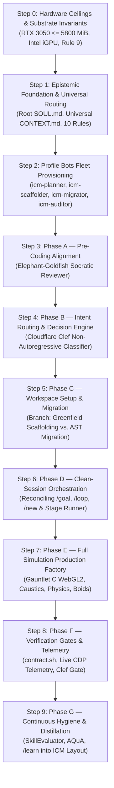

# GDR39 Chronological Synthesis & Structural Harmonization Audit

> **Document Role**: Technical Bridge & Inventory Audit for GDR40  
> **Source Document Audited**: [GDR39 ICM Architecture Blueprint (formatted).md](file:///var/home/imshubhamsocial/Projects/Workspace/Personal/hermes/hermes/devel/docs/research/GDR39/Output/GDR39%20ICM%20Architecture%20Blueprint%20(formatted).md) (92,205 bytes, 1,827 lines)  
> **Target Package**: GDR40  
> **Status**: Complete component catalog, ambiguity reconciliation, and chronological pipeline mapping.

---

## 1. Complete Inventory of GDR39 Technical Assets

To guarantee zero loss of technical content during the GDR40 chronological synthesis, every asset from the GDR39 master blueprint has been indexed below:

### A. The 32 Certified Code Blocks & Scripts

| Block Index | Language | Identifier / Role | Target Path in Architecture | Line Count |
| :--- | :--- | :--- | :--- | :--- |
| **0** | Bash | NVIDIA SkillEvaluator CLI install | System Provisioning | 7 lines |
| **1** | Bash | SkillEvaluator CLI commands | Continuous Auditing | 17 lines |
| **2** | Bash | Google ADK Recipes & AQuA install | Continuous Auditing | 15 lines |
| **3** | Bash | Master Bot Provisioning Script | `~/.hermes/profiles/` | 16 lines |
| **4** | YAML | `icm-scaffolder` config | `~/.hermes/profiles/icm-scaffolder/config.yaml` | 18 lines |
| **5** | YAML | `icm-scaffolder` profile description | `~/.hermes/profiles/icm-scaffolder/profile.yaml` | 5 lines |
| **6** | Markdown | `icm-scaffolder` SOUL persona | `~/.hermes/profiles/icm-scaffolder/SOUL.md` | 17 lines |
| **7** | Python | `icm_scaffolder.py` | `~/.hermes/tools/icm/icm_scaffolder.py` | 44 lines |
| **8** | YAML | `icm-migrator` config | `~/.hermes/profiles/icm-migrator/config.yaml` | 15 lines |
| **9** | Markdown | `icm-migrator` SOUL persona | `~/.hermes/profiles/icm-migrator/SOUL.md` | 15 lines |
| **10** | Python | `icm_repo_migrator.py` (AST 5-Bucket) | `~/.hermes/tools/icm/icm_repo_migrator.py` | 48 lines |
| **11** | YAML | `icm-auditor` config | `~/.hermes/profiles/icm-auditor/config.yaml` | 14 lines |
| **12** | Markdown | `icm-auditor` SOUL persona | `~/.hermes/profiles/icm-auditor/SOUL.md` | 15 lines |
| **13** | Python | `icm_context_auditor.py` | `~/.hermes/tools/icm/icm_context_auditor.py` | 43 lines |
| **14** | JavaScript | `wave_pde.js` (GPGPU wave solver) | `output/aquarium-sim/js/wave_pde.js` | 40 lines |
| **15** | JavaScript | `caustics_shader.js` (Area caustics) | `output/aquarium-sim/js/caustics_shader.js` | 37 lines |
| **16** | JavaScript | `sphere_physics.js` (Buoyancy/drag) | `output/aquarium-sim/js/sphere_physics.js` | 35 lines |
| **17** | JavaScript | `boids_fish.js` (3D boids flocking) | `output/aquarium-sim/js/boids_fish.js` | 49 lines |
| **18** | JavaScript | `main.js` (60 FPS telemetry loop) | `output/aquarium-sim/js/main.js` | 43 lines |
| **19** | Bash | `contract.sh` (Gauntlet C gate) | `benchmarks/gauntlet_c_aquarium/contract.sh` | 35 lines |
| **20** | Bash | Clean session command sequence | Orchestration / CLI | 18 lines |
| **21** | Bash | Deterministic multi-stage runner | `_tools/run_multi_stage.sh` | 17 lines |
| **22** | Markdown | `icm-planner` SOUL persona | `~/.hermes/profiles/icm-planner/SOUL.md` | 20 lines |
| **23** | Python | `egm_goldfish_gate.py` (Goldfish reviewer)| `_tools/egm_goldfish_gate.py` | 57 lines |
| **24** | Markdown | `icm-stage-compiler` SKILL.md | `~/.hermes/skills/icm/icm-stage-compiler/SKILL.md`| 46 lines |
| **25** | Python | `verify_stage.py` (Script ceiling gate) | `.../icm-stage-compiler/scripts/verify_stage.py` | 34 lines |
| **26** | Python | `test_skill.py` (Skill unit test) | `.../icm-stage-compiler/tests/test_skill.py` | 35 lines |
| **27** | Bash | `audit_hermes_home.sh` | `~/.hermes/tools/icm/audit_hermes_home.sh` | 26 lines |
| **28** | Markdown | Root Substrate SOUL persona | `/var/home/imshubhamsocial/.hermes/SOUL.md` | 42 lines |
| **29** | Markdown | Universal Workspace CONTEXT.md | `ws-hermes/CONTEXT.md` | 86 lines |
| **30** | Python | `hermes_decision_router.py` (Clef) | `_tools/hermes_decision_router.py` | 58 lines |
| **31** | Python | `hermes_decision_gate.py` (Clef verifier) | `_tools/hermes_decision_gate.py` | 67 lines |

---

## 2. Structural Defect Analysis & Ambiguity Reconciliation

A forensic comparison reveals four structural issues in GDR39 that must be reconciled during chronological synthesis:

### Ambiguity 1: Dispersed Persona & Profile Definitions
* **Current State in GDR39**: Three profile bots are defined in Directive 2, the `icm-planner` bot is defined in Directive 5, and the root substrate `SOUL.md` is defined in Directive 6.
* **Problem**: An engineer provisioning the system has to jump across 60 pages to gather all configurations.
* **Resolution in GDR40**: 
  * Step 1 establishes the Host Substrate Root `SOUL.md` and Universal `CONTEXT.md`.
  * Step 2 establishes the entire Fleet Provisioning Script and defines all four profile bots (`icm-planner`, `icm-scaffolder`, `icm-migrator`, `icm-auditor`) with their respective `config.yaml` and `SOUL.md` manifests in one unified location.

### Ambiguity 2: Greenfield Scaffolding vs. Brownfield Migration
* **Current State in GDR39**: Greenfield 5-layer scaffolding is introduced in Section 1.1, while legacy codebase migration using the 5-bucket AST parser is presented in Section 2.2.
* **Problem**: The user cannot clearly see the branching point when facing an arbitrary repository.
* **Resolution in GDR40**: 
  * Step 5 (Phase C) introduces a unified decision tree:
    * If starting from an empty directory $\rightarrow$ Execute Path A: Greenfield Scaffolding (`icm_scaffolder.py`).
    * If ingesting an existing Git repo $\rightarrow$ Execute Path B: Brownfield Migration (`icm_repo_migrator.py`).

### Ambiguity 3: Slash Commands vs. "One Task, One Clean Session"
* **Current State in GDR39**: Section 4.1 warns that native `/goal` runs continuously inside a single session, accumulating KV cache and causing context degradation after 8–10 turns. Section 4.2 presents clean-session wiping (`/new`).
* **Problem**: Ambiguity exists on whether to use `/goal` or whether `/goal` is prohibited.
* **Resolution in GDR40**: 
  * Step 6 clarifies the definitive operational rule:
    * Inside a **single stage** with bounded context, `/goal` is encouraged (with `max_turns: 10–15`).
    * Across **stage boundaries**, context must be wiped to zero using `/new --yes <stage-name>` or the multi-stage bash runner. Never carry KV cache from stage $N$ to stage $N+1$.

### Ambiguity 4: Placement of Decision Routing Tools
* **Current State in GDR39**: Cloudflare Clef decision tools are placed in Directive 8 (the very end of the document), even though they are used to route intents and verify stages.
* **Problem**: The routing tool appears after the tutorial that it is supposed to route!
* **Resolution in GDR40**: 
  * Step 4 positions the Cloudflare Clef decision router as Phase B (Task Classification & Routing), directly preceding workspace setup.
  * Step 8 positions the Cloudflare Clef gate verifier alongside `contract.sh` for multi-modal telemetry certification.

---

## 3. The 10-Step Chronological Execution Flowchart

